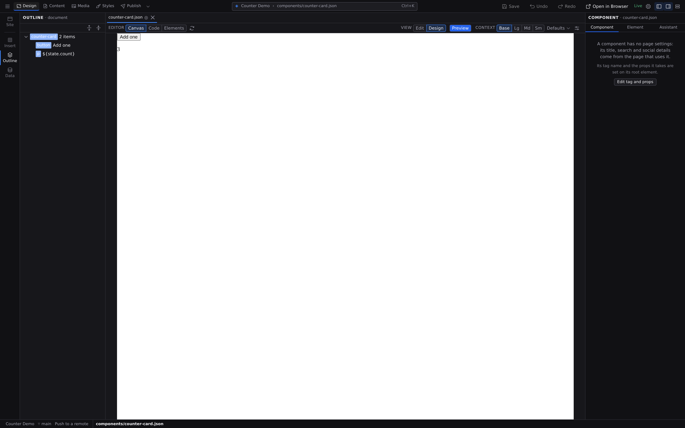
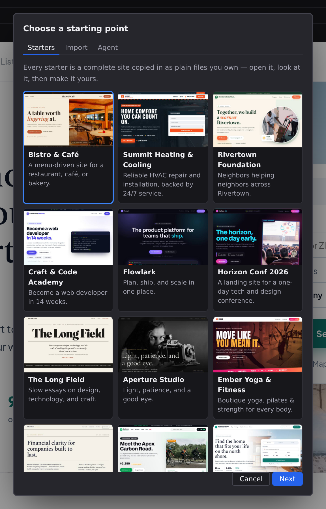
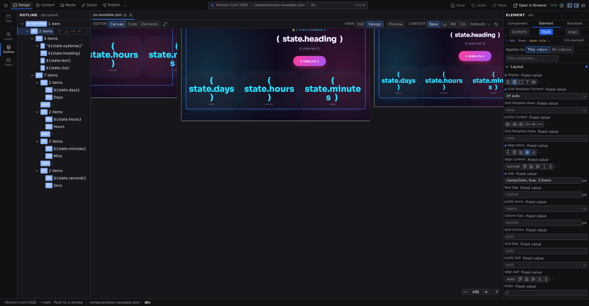
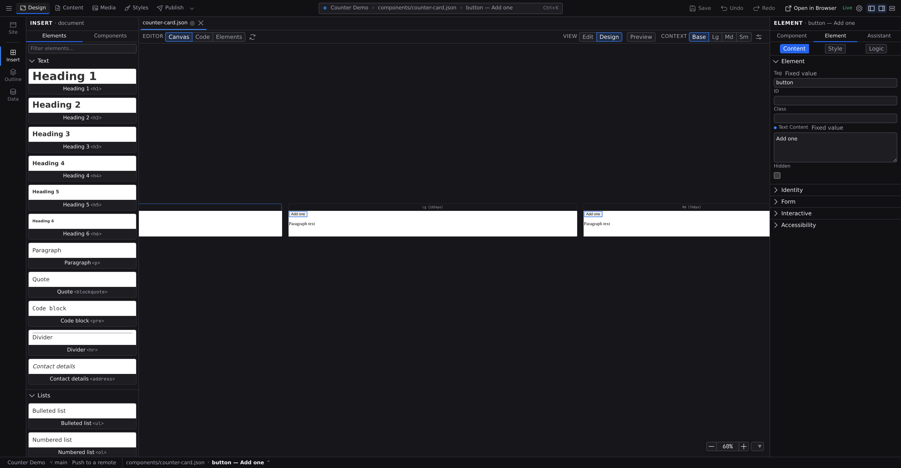
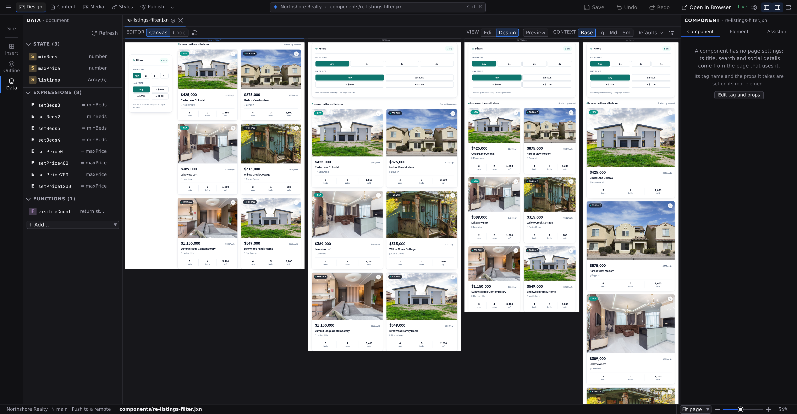
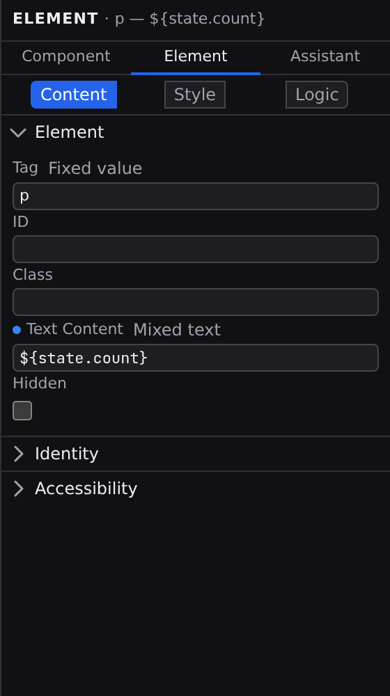
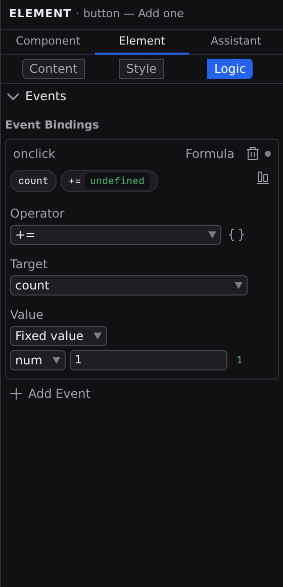
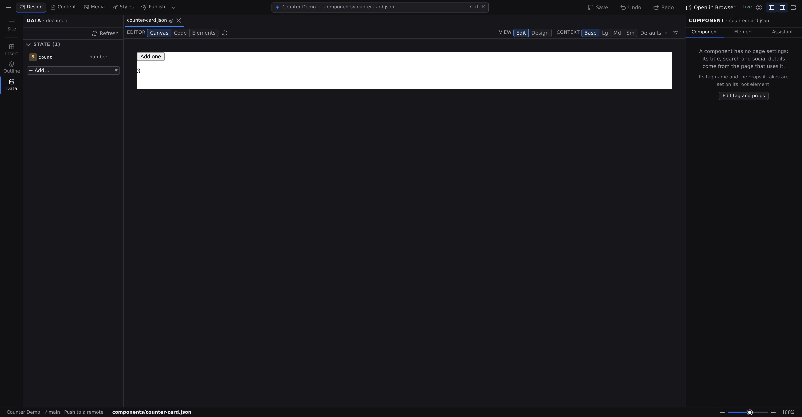
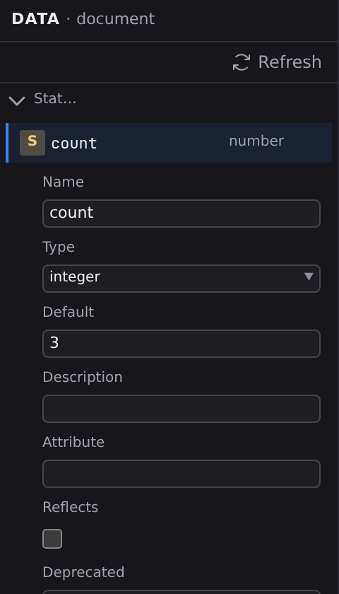
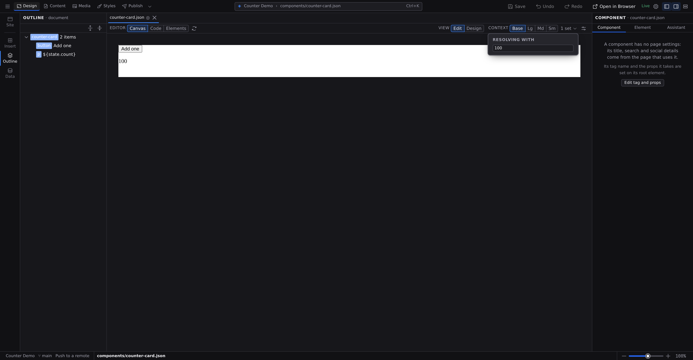

# Tutorial: your first interactive component

In this tutorial you build a `counter-card` component: a button and a line of text that counts the clicks, live. Small as it is, it walks the whole loop every interactive piece of a Jx site is made from, without writing any code: elements on the canvas, a state value, a binding, and an event. All of it happens in the **Design** workspace, where pages, templates and components are built.

**About 15 minutes.** Before you start:

- Have Jx Studio running. **[Install Jx Studio](/docs/start/install)** covers it.
- If Studio is completely new to you, skim **[Your first project](/docs/start/first-project)** first. This tutorial starts where it ends, with a project open.

## 1. Open a project

Any project works. If you already have one from [Your first project](/docs/start/first-project), open it with **Open Project**. Otherwise choose **New Project…**, scroll to the **Start from scratch** card at the end of the starter gallery, click **Next**, name the project (say, "Counter Demo"), and click **Create Project**. Every step of the wizard is explained in **[Create a project](/docs/studio/projects/create)**.

You should now see your project open on the canvas, with **Design** selected among the workspace tabs in the Command Bar (**Design**, **Content**, **Media**, **Styles**, **Publish**). A workspace is the task the window is set up for. If another tab is selected, click **Design** or press :kbd[⌘1]. See **[The workspace](/docs/studio/interface)**.

## 2. Create the component

1. Press :kbd[⌘N] to open **Add new** (in a browser, :kbd[⌘⌥N]), or click the **+** at the top of the Site panel.
2. Choose **Component**.
3. Click **Component name**, type `counter-card`, leave **Start from** on **Blank**, and click **Create component**.

Studio writes `components/counter-card.json`, lists it under **Components** in the Site panel, and opens it in a new tab, an empty canvas ready to fill. Components belong to the Design workspace, so you stay where you are. (When to reach for a component versus a page or layout is covered in **[Pages, layouts, and components](/docs/studio/projects/pages-layouts-components)**.)

## 3. Switch to the Design view

Design is the name of the workspace and also of a view inside it. Component files open in the **Edit** view, so in the **View** control on the pane's context bar, click **Design**.

The canvas now shows your component once per breakpoint, empty for the moment, and the Inspector on the right has three tabs: **Component**, which holds the file's own settings, **Element**, which holds **Content**, **Style**, and **Logic** views of whatever you select, and **Assistant**. Views are lenses on the same file; see **[Editors and views](/docs/studio/interface/modes)**.

## 4. Add a button and a text line

1. Click **Insert** in the **Document** group of the Navigator rail. The **Insert** palette replaces the Site panel in the Navigator.
2. With nothing selected, click the **Button** card in the **Interactive** section. The button is added to the empty component.
3. Click the **Paragraph** card in the **Text** section to add a paragraph, typing `para` into **Filter elements…** if you'd rather not scroll. A card inserts into whatever is selected, as its last child; with nothing selected that's the component's root, so the paragraph lands after the button rather than inside it.
4. Select the button on the canvas. The Inspector moves to its **Element** tab, on the **Content** view.
5. Open the **Element** section if it is collapsed, and replace `Button` in **Text Content** with `Add one`.

You should now see a button labeled **Add one** with the placeholder words `Paragraph text` after it, at every breakpoint. The other ways to insert, dragging cards and the **+** affordance between elements, are covered in **[The canvas](/docs/studio/interface/canvas)** and the **[Insert palette](/docs/studio/design/elements)**.

## 5. Declare the count

The component needs somewhere to keep its number. That's a state entry:

1. Click **Data** in the **Document** group of the Navigator rail to open the **Data** panel.
2. Click **Add a value**, or choose **Value** from the **+ Add…** picker below it. The new entry appears with a placeholder name and its editor open.
3. Rename it first: type `count` into the **Name** field and press :kbd[Enter].
4. Set **Type** to `integer`, then type `0` into **Default**. A new entry starts with an empty default, and an empty string is not something you can add one to.

The panel now shows a **State** section with one row: an **S** badge and the name `count`. Everything else the panel can hold, from computed values to data sources to functions, is covered in **[Data panel](/docs/studio/logic/data)**.

## 6. Bind the text to the count

Now point the paragraph at the value instead of typing fixed text:

1. Select the paragraph on the canvas.
2. In the Inspector's **Element** tab, on the **Content** view, find the **Text Content** row in the **Element** section. Beside its label sits a small chip reading **Fixed value**. That is the row's _value source_, and it says the text is a literal you typed.
3. Click the chip. A short list opens naming every source this field accepts (**Fixed value**, **From data…**, **Mixed text**), each with a line saying what it does. Pick **Mixed text**. Any source is one click away; the chip never cycles you through the ones you didn't want.
4. Studio fills the field with your first state entry: `${state.count}`. Keep it, or mix in words: `Clicked ${state.count} times`.

The chip now reads **Mixed text**: this value is produced from something else, and the paragraph will always show the current count. On the canvas it shows the binding itself, `❪ state.count ❫`, until you preview it. The same four words name a value's source everywhere in Studio (**Fixed value**, **From data…**, **Mixed text**, **Formula**), and each field offers only the ones it can legally hold, which is why Text Content shows three of them. The dynamic ones are explained in **[Formulas and expressions](/docs/studio/logic/formulas)**.

## 7. Make the button count

1. Select the button and open the **Logic** view of the Inspector's **Element** tab, either by clicking it or by pressing :kbd[⌘⇧4]. Logic is where an element's behavior lives: its events, and the condition or repeating-list settings when it has them.
2. In the **Events** section, click **Add Event**. A binding appears on `onclick`, and since the file has no functions yet its value source chip reads **Inline function**.
3. Click the chip to choose how the binding responds, and pick **Formula**, the source for one-step reactions. (**From data…** and **Inline function** are the other two.)
4. In the formula editor, set the **Operator** to `+=`. Set **Target** to `count`. In the **Value** row, leave the source on **Fixed value**, change its type from `null` to `num`, and enter `1`.

A chip strip above the editor summarizes the formula as a `count` chip followed by a `+=` chip. The `+=` chip's badge reads `undefined`, because an assignment changes a value rather than producing one. The three ways an event can respond (**From data…**, **Formula**, **Inline function**) are covered in **[Events](/docs/studio/logic/events)**.

## 8. Try it in Preview

Click **Preview**, the toggle beside the **View** control on the context bar. **Design** stays marked, because it is the view you return to when you click **Preview** again. The paragraph now shows `0`, the resolved value. Click **Add one** a few times.

You should see the number climb with every click. That's the whole reactive loop: the event writes to `count`, and everything bound to `count` updates by itself.

## 9. Watch the value resolve

The **Data** panel also shows what each entry is worth _right now_. If it isn't still open, click **Data** in the **Document** group of the Navigator rail, then click the `count` row to open it: **Resolved to** holds the current number. Stay in Preview, click **Add one**, and watch it change; **Refresh** re-renders the canvas and reads the values again.

When a page ever looks wrong, this panel is where you find out what it actually sees. See **[the Data panel](/docs/studio/logic/data)**.

## 10. Try a test value

Because `count` is a plain state value on a component, it's also one of the component's _props_: an option a page can set when it uses the card.

1. On the context bar, click **Defaults**. The popover headed **Resolving with** holds one field per prop.
2. Type `100` into the **count** field and press :kbd[Enter].
3. The canvas re-renders with the count starting at 100, and the context bar button now reads **1 set**.
4. Clear the field to return to the default of `0`.

Test values are a preview lens only, and are never saved into the component. Props and test values are covered in **[Working with components](/docs/studio/design/components)**.

## 11. Save your work

The document's tab shows a **●** dot for unsaved changes. Press :kbd[⌘S] (macOS) or :kbd[Ctrl+S] (Windows/Linux), or click **Save** in the Command Bar, and the dot goes away.

You should see the dot disappear. When you're ready to publish, the **Publish** workspace (:kbd[⌘5]) takes it from here; your tab stays open in Design while you are there. See **[Source control](/docs/studio/publish/source-control)**.

## What you built

A working, reusable component, and every piece of the interactive toolkit in one pass:

- A **state entry** (`count`) is the component's memory, and automatically its prop.
- A **template binding** (`${state.count}`) is text that follows the value wherever it goes.
- An **event formula** (`count += 1`, assembled from an operator and two operands) is behavior without a line of code.
- **Preview**, the **Data** panel's resolved values, and **test values** are three ways to watch it run.

:::doc-note
Everything landed in one plain file, `components/counter-card.json`: the entry in its `state` object, the paragraph's text as a `${}` template, and the button's `onclick` as an `$expression`. The formats are documented in **[State](/docs/framework/concepts/state)** and **[Reactivity](/docs/framework/concepts/reactivity)**.
:::

## Next steps

- Drag the card onto any page from **Components** in the Site panel, or insert it from the **[Insert palette](/docs/studio/design/elements)**, where your components appear at the top.
- Style its spacing, color and hover states with the **[Style inspector](/docs/studio/design/style-inspector)**.
- When one step isn't enough, build multi-step handlers as **[statements](/docs/studio/logic/statements)**.
- Keep going: **[Tutorial: a blog with content collections](/docs/start/first-collection)**.
