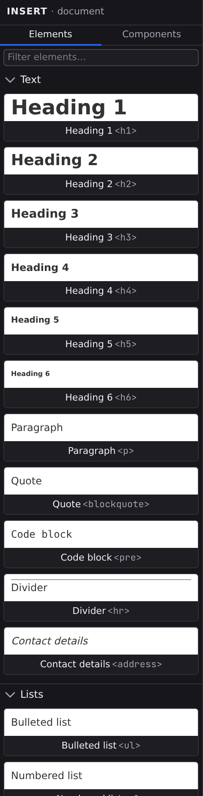

# Insert palette

Insert is the palette of things you can add to the page: the standard HTML building blocks on one tab and your own components on the other, laid out as cards.

## Open it

Click **Insert**, the first button in the **Document** group of the Navigator rail in the **Design** workspace. It stays open while you work: drag a card onto the canvas, and the next one is still there to drag. Two more doors:

- In the **[Outline](/docs/studio/design/layers)** panel of an empty page, click **Add an element**.
- Press :kbd[⌘K] and type `>Show Insert`.

It opens in the Navigator, under an **INSERT · document** header. Unlike the other document panels it is happy with no document open, because an element palette still means something before you have chosen where to put anything.

## What's in the palette

Two tabs run across the top of the panel:

- **Elements** holds the HTML building blocks, grouped into sections: **Text**, **Lists**, **Media**, **Layout**, **Interactive**, **Forms**, **Tables**, **Inline text** and **Advanced**. The everyday ones come first. **Inline text** (bold, italic, highlight and the like, which usually go inside a paragraph) and **Advanced** start closed; click a section's header to open or close it, and Studio remembers your choice.
- **Components** holds your project's own components, plus components from installed packages once they're enabled for the project (see **[Dependencies](/docs/studio/projects/dependencies)**). Each card renders a live preview, so you see the real thing before you place it. A project with no components yet says how to make one.

Each element card shows a small preview and the element's name, such as **Heading 1**, **Bulleted list** or **Image**, with its HTML tag beside it. Hover a card to read what the element is for. Names are in English for now; Studio is built to show them in your browser's language once a translation for it ships.

Elements a page's body can't hold are not offered: the document's own `html`, `head` and `body`, and the tags that belong in a page's head (`title`, `meta`, `link`, `base`, `script` and `style`). A page's title, description and other head tags are set on the Inspector's **Page** tab.

Type in the filter box under the tabs to narrow the tab you're on. An element matches by name or by tag, so `image` and `img` both find **Image**, and a section that starts closed opens to show its matches. When nothing on this tab matches, the panel says so and offers **Clear the filter**, and if the other tab has matches it offers to show those too.

## Insert by click

1. On the canvas or in [Outline](/docs/studio/design/layers), select the element you want to insert into.
2. Click a card on either tab. The new element lands inside the selection, after its existing children. A component card also adds the component to the page's imports, exactly as dragging it does, so the page can render it.

With nothing selected, the element is added at the end of the document. With [several elements selected](/docs/studio/design/layers#select-several-at-once), it lands inside the last one you added to the selection, because inserting is a one-place verb and that is the place you pointed at most recently.

## Insert by drag

For an exact placement, drag the card instead:

1. Press and drag any card toward the canvas.
2. As you move over the page, an indicator line shows where the element will land: before, after, or inside the element under the cursor.
3. Drop to insert, or press :kbd[Esc] to cancel.

A block (a component, an image, a section) dropped over a paragraph or a heading lands above or below it, never inside the sentence. Only text-level elements such as a link or bold text go inside a paragraph. A component arrives together with its import, so one :kbd[⌘Z] takes back both.

The new element arrives selected, and the Inspector switches to its **Element** tab, ready for the [Content](/docs/studio/design/properties) and [Style](/docs/studio/design/style-inspector) views. Dragging works the same in Edit and Design view. **[The canvas](/docs/studio/interface/canvas)** covers the other ways to insert: the **+** affordance between elements and the slash menu, both of which list your components under a **Components** heading after the HTML elements. The **[Site panel](/docs/studio/interface#the-site-panel)**'s component cards drag onto the canvas the same way.

:::doc-note
Inserting adds one element node to the open file. A component card adds an instance tag like `<site-card>`. The format is described in **[Components](/docs/framework/concepts/components)**.
:::

## Next

- Get your own cards to appear here with **[Working with components](/docs/studio/design/components)**.
- Rearrange what you inserted in the **[Outline panel](/docs/studio/design/layers)**.
