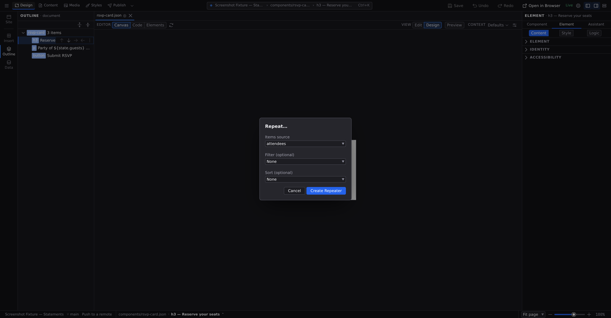

# Repeaters

A repeater renders one element once per item of a list: design a single card, bind it to your products, and get a card per product. The element you design becomes the repeater's _template_; the list it follows can be state, a content collection, or a data source.

## Turn an element into a repeater

1. Design one instance of the repeating thing: one card, one row, one gallery tile.
2. With it selected, run **Repeat…** by right-clicking it on the canvas, or press :kbd[⌘K] and search for the command by name.
3. In the dialog, pick the **Items source**: a list from the document's state, or **Create new...** to declare a fresh one by name.
4. Optionally pick a **Filter** or **Sort** function, if the document defines any.
5. Click **Create Repeater**.

Your element is now the template of a repeater, marked **↻** in Outline. The repeated items render directly where the element stood. No wrapper is added around them.

The command needs an element with a sibling position to repeat into, and refuses on the document root and on a repeater you have already made. See **[Commands](/docs/studio/interface/commands)** for the full list.

## Bind the list

The items source is what makes a repeater useful. It can be:

- **A plain list in state**: start with `Create new…` and fill in items later in the **Data** panel.
- **A content collection**: every blog post, product, or team member in your project's content. See **[Content types](/docs/studio/projects/content-types)**.
- **A data source**: anything that produces a list, like a `Request` fetching from an API.

Declaring and feeding these lives in **[Logic](/docs/studio/logic)**. With the repeater selected, the Inspector's **[Logic tab](/docs/studio/logic/events)** (:kbd[⌘⇧4]) shows a **Repeating list** section where you can rebind **Items** and add or change **Filter** and **Sort** after the fact. Binding a list and binding a click handler are the same job, so they share a tab.

All three are ordinary Inspector rows. Each carries a **value source** chip offering **Fixed value** or **From data…**, plus a provenance dot you can click to clear **Filter** or **Sort** again. That is the same vocabulary every bindable row in Studio uses, described in **[Formulas and expressions](/docs/studio/logic/formulas)**. Filter and Sort are always drawn, empty until you fill them: type into one and it is set, clear it and it is gone. **Items** is the one row a repeater cannot do without, so it has nothing to clear.

The Content tab has nothing to say about a repeating list, and says so: select one and Content offers an **Open Logic** button, because its items, filter, sort and template are all wiring.

## Edit the template

Select the repeater and click **Edit template →** in the **Repeating list** section, or just click into the repeated content on the canvas. On the design canvas the template renders once, as the single element you design; switch on the **Preview** toggle to see the list expanded with its real items (see **[Modes and preview](/docs/studio/interface/modes)**).

Inside the template, each item's data is in scope:

- While editing text, the **Insert data** button on the block action bar offers `item` (the current item) and `index`, its position, alongside the item's own fields: `item.data.title` for a content collection's fields, or `item.name`-style fields for lists of records. The same insertion is a command, **Insert Data**, so you can reach it from :kbd[⌘K] with the token typed rather than picked.
- In the Inspector, any row whose **value source** is set to **From data…** offers `item`, `index` and the item's own fields alongside the document's signals, so you can pick `item.data.title` from the list instead of typing a template. The same fields appear under **List item** in a formula's operands, including in event handlers.

Studio works out those fields without running anything, from whichever of these the list reads:

- A content collection: the fields its schema declares, plus `item.id` and `item.body`. A field that references another collection also lists that entry's fields, such as `item.data.author.data.name`.
- A signal with a declared schema, including a shared type from `$defs`.
- A signal holding a sample value, or an inline list: every field found in its first rows.
- A field of an outer item, for a list inside a list. A nested list's **Items** offers the outer item's list fields, and its template then offers the fields of each entry in that list.

When the shape can't be deduced, as with a list computed by a formula, the picker offers `item` and `index` alone. You can still reach a field Studio doesn't know about with **Mixed text**, and a binding to one keeps showing in the picker as you wrote it.

Bind the template's text and attributes to item fields and every rendered copy fills itself in from its own item.

### Show an item's body

A Markdown entry's body can fill any empty element in the template, such as the biography area of a team card:

1. Select the empty element in the template.
2. In the Inspector's **Content** view, open the **Element** section and set the **Text Content** row's value source to **From data…**.
3. Pick `item.$children`.

The row now reads **Content**. The design canvas shows the binding as `❪ item.$children ❫`, which you can select but not type into, and **Preview** draws each entry's own headings, paragraphs and links. To go back to text, pick another field or switch the row to **Fixed value**.

`item.$children` is only offered on this row, because the rest of Studio's bindings hold a single value and a body is a tree of elements. It is not offered for a collection in a format with no parsed body, such as CSV, or on an element that already has children of its own.

:::doc-note
The pick is stored as computed children rather than as a pointer, so in a Markdown page it reads `::div{children="${item.$children ?? []}"}`. Keep `@jxsuite/parser` current in a site that uses this: versions from before Studio offered this binding drop the attribute on save.
:::

On the design canvas, text the template draws shows its binding, such as `❪ item.data.title ❫`, so you can see and edit what it reads. A component in the template is handed the list's first item instead: a card component shows the first entry's title, dates and picture, because a component that formats a date or a language needs a real value to draw at all.

:::doc-warning
The template is one element styled once, so changes to it apply to every repeated item. To make one item special, style by position with a selector like `:first-child` (see **[Hover states and selectors](/docs/studio/design/states-and-selectors)**) or use data-driven styling.
:::

:::doc-note
A repeater is stored in the file as an `Array` node with `items` (the binding), `map` (the template), and optional `filter` and `sort`. The reactive model behind it is described in **[Reactivity](/docs/framework/concepts/reactivity)**.
:::

## Next

- Feed repeaters from the collections defined in **[Content types](/docs/studio/projects/content-types)**.
- Make the template a reusable component with **[Working with components](/docs/studio/design/components)**.
  - packages/studio/src/surfaces/convert-repeater.ts
