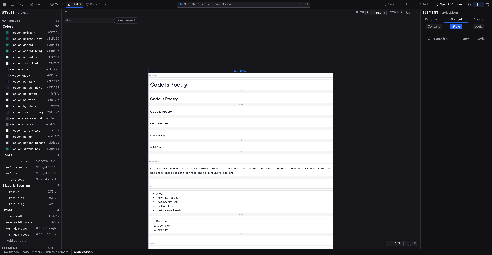

# Project Styles

Project Styles catalogs your elements: every heading, paragraph, button, list, table, and form control, plus your components, rendered as specimen cards with their current default styles. Instead of styling one `h2` on one page, you style what _every_ `h2` looks like, in one place. Project Styles is the **Styles** workspace: click **Styles** in the Command Bar (:kbd[⌘4]), or run **Go to Styles** from :kbd[⌘K], whether or not the project file is already open. It shows your project file in three views: **Variables**, your site's CSS custom properties (see **[Design tokens](/docs/studio/design/tokens)**), where the workspace opens the first time; **Elements**, the catalog this page describes; and **Code**, the file as text. After the first visit it opens on whichever of Variables and Elements you were last in. The **Styles** panel on the left takes you to each one, and the **Editor** control on the pane's context bar switches between them too. See **[Modes and views](/docs/studio/interface/modes)**.

Your project file opens here, because that's the natural home for site-wide defaults. **[Project settings](/docs/studio/projects/settings)** edits other parts of the same file, and the three views are three readings of it, sharing one undo history and one unsaved-changes flag. A component or another JSON document also offers **Elements** in its own **Editor** control, which styles that file's element defaults instead.

## Read the catalog

Project Styles shows the catalog at one breakpoint at a time, the one the context bar's size switcher names, so the specimens stay readable. Pick another size there and the catalog redraws at that width, so an element default that changes at Tablet is visibly different at Tablet. The catalog renders through the real runtime, exactly as the defaults will render on your pages.

Each component card shows the component with the same sample its preview in the Site panel uses: the example values its definition declares. A component with no examples is drawn with its defaults, and one that can't be drawn either way shows a plain box with its tag name instead of an empty card.

Two controls sit above the canvas: a **Filter** box to narrow the catalog by name, and a **Customized** toggle to show only the elements you've already styled.

## The Styles panel

The **Styles** panel is the Navigator of the Styles workspace, and it lists everything the workspace edits, in three sections:

- **Variables**: every CSS custom property in your project, by its name (`--color-accent`), grouped into Colors, Fonts, Sizes & Spacing and Other, with a count on each group and a swatch beside each color. Click a group or a variable to edit it in the Variables view, which scrolls to it. **Add variable** opens the Variables view on the group's add row.
- **Elements**: the element defaults by tag name (`h1`, `a`, `button`), with the nested parts of an element one step in (a list's `li`, a table's rows and cells), then your components. A dot marks every tag your project file already styles, and the heading counts them (**3 styled**). Click one to select it on the Elements view's canvas, brought into view, with the Inspector on its **Style**. The Inspector is shown only beside the Elements view; the Variables view is edited in place and gets the full width.
- **Color schemes**: the light and dark schemes your project declares, each with the media query that selects it. **Manage color schemes…** opens **Project settings › Advanced › Contexts**, where schemes are declared.

The Styles panel only takes you places; every change is made in the view it opens, and saves the way that view does (below).

A page or a component has an **Elements** view of its own, in the Design workspace; there the **Outline** panel lists the same catalog for that file.

## Style an element type

1. Click a specimen card on the canvas, or its row in the **Styles** panel. The specimen is outlined on the canvas, the Inspector switches to the **Style** tab on its own, and the Command Bar's path and the Inspector header both name the tag you picked (`project.json › h1`, **Element · h1**).
2. Read the Target Line before you type. Its scope chip reads **all `<h1>` in this document**. You are editing the element type, not one element. See **[Style inspector](/docs/studio/design/style-inspector)**.
3. Edit styles with the full inspector: sections, provenance chips, and all.
4. Watch every panel update: you're styling the element type, so every specimen of it changes at once, and so does every matching element the chip named.

The Target Line works the same as in Design mode: the **breakpoint** segment says which screen size a default is scoped to (see **[Breakpoints](/docs/studio/design/breakpoints)**), and the **selector** segment adds states, so you can give every link a default `:hover` in one edit. Select the link specimen and the menu offers the states a link has, `a :hover`, `a :visited` and the rest, each one written under `a`. The specimen is a real link, so the colour and underline you set on it are the ones your pages will show (see **[Hover states and selectors](/docs/studio/design/states-and-selectors)**). Nested parts style as compound selections, like the header cells inside tables.

## Know what an edit reaches

The scope chip is the difference between "this heading" and "every heading":

- On a component or another JSON document, styling `h1` reaches **all `<h1>` in this document**.
- On a **layout** (and on your **project file**), the same edit reaches **all `<h1>` in this project**: every page inheriting that style follows it. A warning band opens under the line naming how many elements in how many files it affects, with **Show affected** to list them file by file; where the project can't be searched it says the number is **unknown** rather than guessing.
- On your project file with nothing selected, the line reads **every page in this project**. That is the file's own root style (`:root` and `body` on every route), so there is no tag to count, and the band says as much instead of printing a number it can't stand behind.

The chip is there before your first keystroke, which is the point: this catalog widens every edit from one element to a whole tag, and you should not have to discover that from the result.

An element default you set here is an edit to the open file like any other: the tab shows its unsaved dot and **Save** (:kbd[⌘S]) writes it. The **Variables** view saves differently, and says so at its top: a variable change is written as you make it, together with any element default still waiting for Save.

A value that arrives from your project's tokens rather than from this file carries an inherited chip reading **from site tokens**, so a default you did not write here is never mistaken for one you did. It has nowhere to jump to, because that value lives in the project's site-wide style, and you edit it in **[Design tokens](/docs/studio/design/tokens)**.

A property your pages inherit, such as the font, size, line height or colour, shows what the element type would inherit when you leave it unset, with a chip naming where it comes from. Your project file's own root style is the page `body`, so an unstyled `h1` reads **from body** and shows the body font, and a cell nested under `table` reads **from table** for a colour the table sets. Set the property on the element type and your value takes over.

## Project Styles, element styles, or component styles?

Three layers, from broadest to narrowest:

- **Project Styles defaults**: "every `h2` looks like this." Your typography, link, and form baseline. Change it here and the whole site follows.
- **Component styles**: "this card component looks like this, wherever it's used." Style the elements _inside_ a component definition in Design mode; see **[Working with components](/docs/studio/design/components)**.
- **Per-element styles**: "this one element is special." The [Style inspector](/docs/studio/design/style-inspector) on a single selection, layered on top of both.

The narrower layer wins where they overlap, so keep the common look in Project Styles and reserve per-element styling for true exceptions. [Design tokens](/docs/studio/design/tokens) slot in underneath all three, so defaults built from tokens keep even your baseline swappable.

:::doc-note
Element defaults are saved as tag-named rules in the open file's top-level `style`. In `project.json` they become site-wide and merge into every page and component. The format is described in **[Styling](/docs/framework/concepts/styling)**.
:::

## Next

- Name the values your defaults are built from in **[Design tokens](/docs/studio/design/tokens)**.
- See how Project Styles fits among the editors and views in **[Modes and views](/docs/studio/interface/modes)**.
