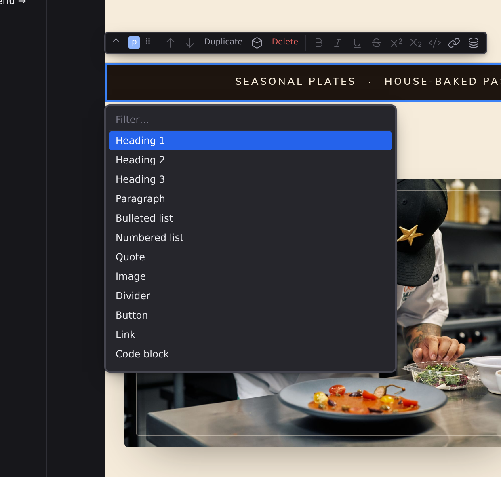

# Slash commands

The slash menu inserts blocks without leaving the keyboard: while editing text, type `/` and a menu of everything you can insert opens under your cursor. It's the fastest way to build a page up from a blank paragraph.

## Insert a block

1. While editing text, type :kbd[/] on an empty line or after a space.
2. Keep typing to filter the list: `he` narrows to the headings, `img` finds Image.
3. Move through the matches with :kbd[↓] and :kbd[↑], then press :kbd[Enter], or click an entry.
4. The block appears and you're already editing it, so keep typing.

On an empty paragraph, the paragraph itself becomes the block you chose. On a line that has text, the text stays where it is and the new block lands right after it.

To close the menu without inserting anything, press :kbd[Esc], click anywhere else, or delete back past the `/`. And a slash in the middle of a word ("and/or") just types a slash; the menu only opens at the start of a line or after a space.

The menu also has a name. **Insert: Insert Block…** in the command palette (:kbd[⌘K], then `>`) opens the same list at the caret, which is how you reach it without typing anything. Bind it to a key of your own in **Preferences › Keyboard**, or ask the assistant for it. Opened that way there is no `/` in your text to filter against, so the menu brings its own filter field, and choosing a block leaves everything you have written exactly where it is.

## The block list

| Command           | Element      | What you get                                      |
| ----------------- | ------------ | ------------------------------------------------- |
| **Heading 1**     | `h1`         | The page's main title                             |
| **Heading 2**     | `h2`         | A section heading                                 |
| **Heading 3**     | `h3`         | A subsection heading                              |
| **Paragraph**     | `p`          | Body text                                         |
| **Bulleted list** | `ul`         | A list whose order does not matter                |
| **Numbered list** | `ol`         | A list whose order matters                        |
| **Quote**         | `blockquote` | A passage quoted from another source              |
| **Image**         | `img`        | A picture                                         |
| **Divider**       | `hr`         | A line between two parts of the page              |
| **Button**        | `button`     | A button                                          |
| **Link**          | `a`          | A link to another page or place                   |
| **Code block**    | `pre`        | Text kept exactly as typed, in a fixed-width font |
| **Table**         | `table`      | Rows and columns                                  |
| **Container**     | `div`        | A box that groups other elements                  |
| **Section**       | `section`    | A part of the page about one topic                |

The names are the ones on the [Insert palette](/docs/studio/design/elements)'s cards, so an element is called the same thing wherever you insert it. Filtering matches either the name or the element's tag, so `ol` finds Numbered list and `h1` finds Heading 1.

## Components

After the blocks, under a **Components** heading, the menu lists your components by tag, such as `<site-card>`: your project's own first, then the ones your installed packages provide. Filtering reaches them too, so `card` finds `<site-card>`. Choosing one places an instance of the component with its default settings, and adds the component (or its package) to the page's imports in the same step, the way dragging it from the [Insert palette](/docs/studio/design/elements) does. On an empty paragraph the component replaces it; on a line with text, it lands right after it.

The canvas **+** between elements opens the same list, Components included. That menu is frozen over the **+** you clicked: moving the pointer across the page does not move it, so you can reach any row. It closes when you pick one, press `Escape`, click elsewhere, or scroll or zoom the canvas.

:::doc-tip
The same menu appears when you click the name badge on the block action bar to convert a selected element into something else; see **[The canvas](/docs/studio/interface/canvas)**.
:::

## Next

- Everything else about writing on the page: **[Writing and formatting](/docs/studio/editing/writing)**
- The other ways to add elements, the + affordance and drag and drop: **[The canvas](/docs/studio/interface/canvas)**
