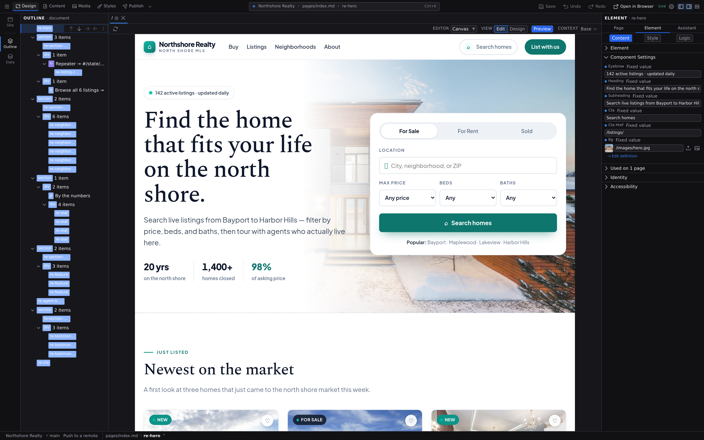

# The workspace

The Jx Studio window is one workspace with a fixed set of regions: the **Command Bar** across the top, the **Navigator** (a labelled rail and the panel it opens) on the left, the **pane grid** in the middle with the canvas in it, the **Inspector** on the right, the **Bottom dock** under the panes, and the **status bar** along the bottom, with the **jump bar** in the middle of it naming where you are. This page walks through each one. For a quicker orientation, start with **[A tour of Jx Studio](/docs/start/studio-tour)**.

Studio's own labels, buttons and headings can't be selected, so dragging across the window never highlights the interface. Text you may need to copy still can be: a dialog's message, the sign-in code GitHub gives you, anything in a text field or the code editor, your conversation with the assistant, the logs in Problems and Activity, the version and commit on the About window, the error details if Studio ever refuses to start, and your page on the canvas.

## Command Bar

The bar across the top of the window. Everything in it is a command, so what you see here, what the [command palette](/docs/studio/interface/quick-access) offers and what a keyboard shortcut does can never disagree.

From left to right:

- The **Studio menu** (the ≡ button at the left edge) holds the commands that don't need a permanent button, each with its own keyboard shortcut printed beside it: **Open Project…**, **Open Recent…**, **New Project…**, **Preferences…**, **Zen Mode**, and the rest.
- The **workspace tabs** (**Design · Content · Media · Styles · Publish**, :kbd[⌘1] to :kbd[⌘5]) switch what you are working on. See [Workspaces](#workspaces). The **Publish** tab counts the changes you have not published yet.
- The **Command Center pill** sits in the middle: `◈ project › document › selection`, with :kbd[⌘K] at its right end. It names the project you're in, the document you're editing and the element you have selected, and each segment is a button that opens the palette already scoped to that level. Click the pill's empty space to open the palette with nothing pre-picked. The pill is where you go to _search_ for a place; the [jump bar](#the-jump-bar) in the status bar is where you _step_ to one.
- The **verb cluster** on the right holds the four actions worth a permanent button: **Save**, **Open in Browser**, **Undo** and **Redo**. A greyed-out one tells you in its tooltip what it is waiting for: **Save** stays greyed out until the document has unsaved changes, and lights up with the first keystroke.
- The **Settings** gear opens a menu rather than a panel. See [The Settings menu](#the-settings-menu).
- **Dock toggles** for the Navigator (:kbd[⌘B]), the Inspector (:kbd[⌘⌥B]) and the Bottom dock (:kbd[⌘J]).

In the desktop app, the window's minimize, maximize and close controls also live in this row.

**Open in Browser** (:kbd[⇧⌘O] on macOS, :kbd[Ctrl+Shift+O] on Windows/Linux) opens the page you're editing in your own browser, the fastest way to check the actual page instead of the canvas's approximation of it. It opens **at the route it will be published at**, on a local address of its own, so styles, scripts and images load the way they will in production and every link goes where it will go once the site is live. You can click through the whole thing.

Nothing is compiled on the way there. Your project's own files are served as a site and each page is assembled as it's asked for, which is why it appears at once, and why it shows **the work in progress rather than the last save**. Keep typing and the page reloads as you go, including edits to a layout or a component you have open in another tab. Save, and it reloads once more against the file you just wrote.

Press it again and you get **the same tab**, moved to whatever page you're on now. One project, one preview tab, however many times you press it. Your browser won't come forward on its own when that happens, because a page can't raise a tab you're not looking at, so Studio tells you which page it moved to and you switch over when you're ready. Close the tab and the next press opens a fresh one.

It is always there. When the open file has no route it's disabled and its tooltip says why: a component isn't a page, a `[slug]` route needs a value picked in the pane context bar's **resolving with** popover first, and a project that doesn't build a site has nothing to serve.

**Build Site** is the other half, and it answers a different question: not "what does this page look like?" but "does my site build?" It's in the Studio menu and the Command Center. It runs the real compiler (bundling, image variants, the sitemap and the rest) and reports what it produced. That's the one to reach for before you publish; Open in Browser is the one for everything else.

## Workspaces

Studio has five workspaces, one for each kind of work. Every open tab belongs to exactly one of them, and each pane's tab strip shows only the tabs of the workspace you are in. Nothing is closed when you switch: the other tabs keep their places and come back with their workspace.

- **Design** (:kbd[⌘1]): pages, layouts, components and every other file, on the canvas. It is the only workspace with the rail.
- **Content** (:kbd[⌘2]): the [Content workspace](/docs/studio/projects/browse), with the Collections panel, a home tab for one collection at a time, the content grids, and every entry of a content collection, written on the canvas inside its template.
- **Media** (:kbd[⌘3]): your images, video, audio, documents and fonts in one library you can filter, search, upload to, replace and delete from, and the viewer for each one. See [Media](/docs/studio/projects/media#the-media-workspace).
- **Styles** (:kbd[⌘4]): [Project Styles](/docs/studio/design/stylebook) over `project.json`, in three views: **Elements** (the default look of each element type), **Variables** (your [CSS custom properties](/docs/studio/design/tokens)) and **Code**.
- **Publish** (:kbd[⌘5]): your unpublished changes and the comparison of each one.

Switching to a workspace takes you back to the tab you were last in there. When it has no tab open it opens its home instead: the Content home on a collection for Content, Project Styles for Styles, the media library for Media, and a home page of its own for Publish. Design with nothing open shows an empty canvas. Closed a workspace's home? Click its tab in the Command Bar again and the home comes back.

Opening a document switches to its workspace for you, so opening a page from the Content workspace lands you in Design, and opening an entry lands you in Content. The same goes for a second pane: it only ever shows a tab of the workspace you are in, and **Compare With…** on a document from another workspace switches you to that workspace to show it.

Each workspace sets up the window for its kind of work every time you enter it: Design opens the Navigator and the Inspector, Styles opens the Outline beside the Style tab, and Media and Publish give the whole width to their own page. Content opens the Navigator on its Collections panel and gives the rest of the width to the Content home, and opens the Inspector only while you write an entry on the canvas. The dock toggles work in every workspace until you leave it, and Design comes back on the Navigator panel you left it on. The workspace you were in is remembered per project, so a project reopens where you left it.

**Project settings** is a dialog rather than a workspace: it opens over whichever workspace you are in, and closing it leaves you there. See [Project settings](/docs/studio/projects/settings).

## Navigator rail

The vertical strip on the far left, drawn in the **Design** workspace. Every button carries a **text label under its icon**, and the buttons are split into two labelled groups, because a panel is either about your whole project or about the one document in front of you:

**Project**

- **Site**: your project the way a visitor meets it. See [The Site panel](#the-site-panel). This is the panel the Navigator opens on.

**Document**

- **Outline**: the element structure of the open page or component, as a tree you can select and reorder. In the Styles workspace it lists the element catalog instead, or your CSS variables beside the **Variables** view.
- **Data**: the values, data sources and functions the document knows about, with what each one currently resolves to. See [Logic](/docs/studio/logic).

Clicking the button of the panel that's already open collapses the Navigator; clicking any button brings it back. A document-level panel with no document open says what it needs. Every panel is also in the palette as **Show** and its name, for example **Show Files**.

### Developer panels

Two panels are for working with the project as files and packages, and they stay off the rail until you ask for them: turn on **Show developer panels** in **[Preferences › Appearance](/docs/studio/interface/preferences)** and they join it.

- **Files** (in the Project group): the project file tree. Open, rename, convert and organize the files in your project folder. **New File…** (from the panel's toolbar, or from a folder's right-click menu) opens the [creation dialog](#creating-a-file), which asks for a name and offers a **Format** picker beside it. Studio picks the starting content from the format you choose. The tree leaves out whatever your project ignores; see [Files the tree hides](#files-the-tree-hides). Drag files in from your desktop and they upload into whichever folder you drop them on; see [Media](/docs/studio/projects/media). Drag a file onto the other pane's strip, or right-click it and choose **Open to the Side**, to open it in a [second pane](/docs/studio/interface/tabs#two-panes) instead of the one you are in. On a [multilingual project](/docs/studio/interface/languages), a file under a language's directory carries that language's name beside it: _français_, not _French_.
- **Packages** (in the Document group): the components and packages the open document pulls in. See [Dependencies](/docs/studio/projects/dependencies).

With the switch off, both are still one palette row away: **Show Files** and **Show Packages**.

**Insert**, the palette of elements and components you can add to a page, is not on the rail either, because you reach for it at the moment you're placing something, and it is not a view you sit in. Run **Show Insert** from the palette (:kbd[⌘K]) to open it in the Navigator. **Source Control** is off the rail as well: run **Show Source Control** from the palette, and the **Publish** tab in the Command Bar counts your changes. See [Publish](/docs/studio/publish).

### The Site panel

The Site panel lists your project the way you think about it: pages by address, then the parts pages are made of. A filter at the top narrows all four sections at once, and a section with nothing left in it keeps its heading and says so, so you can always tell the filter is what emptied it. The **+** beside the filter opens the **New** menu for a page, template, component or collection entry.

- **Pages** are listed by the address a visitor types, in the order the site resolves them: the home page first, then the other fixed addresses, then the ones with a value in them (`/blog/:slug`). A page that gives every entry of a collection its own address sits under a row naming that collection and how many entries it has, labelled for what it is, such as **Post page**. Click a page to open it.
- **Templates** are your layouts, with how many pages use each one when Studio can count them. Click one to open it.
- **Components** are cards that show each of your components rendered live, followed by the components your installed packages provide, listed by tag. Click one of your cards to open the component, or drag any card onto the canvas to place one; it is imported into the page as it lands, along with its package. Clicking a package's card opens the **Packages** panel.
- **Media** shows thumbnails of the images and files in your `public/` folder and in every collection's `images/` folder. Drag one onto the canvas to place an image (or a link, for a file) that points at it. Clicking one opens it in the **Media** workspace, as its tooltip says; :kbd[⌘1] brings you back to Design. **Open Media** switches to the Media workspace.

The row of the document you have open is highlighted, and the panel keeps up as files are added, renamed and removed, whether by Studio or by another program.

### The Settings menu

The **Settings** gear at the right of the Command Bar opens a menu rather than a panel:

- **Preferences…** (:kbd[⌘,]) holds the settings that belong to Studio itself and follow you between projects: the theme, the AI provider, your accounts, the keyboard sheet. Its submenu jumps straight to one of those four. See **[Preferences](/docs/studio/interface/preferences)**.
- **Open Project Settings** (:kbd[⌘⇧,]) holds this project's configuration, from the site name and languages through extensions to contexts, data shapes and packages. Its submenu lists every section in the order the dialog lists them, General first, then Integrations, then Advanced, with a divider where each group starts, so you can land on the one you want instead of arriving at Overview and hunting. See **[Project settings](/docs/studio/projects/settings)**.

Clicking an entry opens that dialog where you last left it; following its submenu opens it on the section you picked. A divider separates what belongs to the app from what belongs to the project. With no project open the project entry is still listed, greyed, saying what it needs, so the menu tells you what Studio can do before you have opened anything. Project Styles is not in the menu: it is the **Styles** workspace, one tab along in the Command Bar.

## Navigator dock

The dock to the right of the rail shows one panel at a time, under a header naming the panel and the level it works at: `FILES · project`, `OUTLINE · document`. That header is how you always know which panel you're looking at and whether closing the last document would empty it.

Drag the dock's inner edge to resize it (up to half the window), and double-click that edge to snap back to the default width. The edge is a keyboard stop too: :kbd[Tab] to it, then :kbd[←] and :kbd[→] move it a step at a time (:kbd[Shift] for a larger one), :kbd[Home] and :kbd[End] take it to its narrowest and widest, and :kbd[Enter] snaps it back to the default width the way a double-click does. The bottom dock's edge answers :kbd[↑] and :kbd[↓] instead.

Both trees in the dock, **Files** and **[Outline](/docs/studio/design/layers)**, answer the same keys. :kbd[Tab] enters the tree at the row you were last on, :kbd[↑] and :kbd[↓] walk the rows, :kbd[→] opens a folder or steps into it, :kbd[←] closes it or steps out to the one it sits in, and :kbd[Home] / :kbd[End] jump to the ends of the whole tree rather than to the ends of what is on screen. Typing a letter jumps to the next row whose name starts with it. Everything the tree does not use reaches your commands untouched, so cut, paste and delete still work on the row you are standing on.

## Moving a file

Drag a row onto a folder and the file moves into it, taking its open tab with it and repairing every reference to it across the project (see [Renaming and moving](/docs/studio/projects/pages-layouts-components)). The folder highlights as you hover it, and that highlight is the whole promise: if nothing lights up, nothing will happen when you let go.

Some drops are refused, and refusing them looks like refusing them. A file dropped on the folder it is already in stays where it is. A folder cannot be dropped inside itself or into anything it contains. Dropping on a file does nothing, because a file has no inside. To move something to the top level of your project, drop it on the empty space below the tree, which highlights as a whole while nothing else does.

## Creating a file

Pages, templates, components, collections and uploads are made with **Add new** (:kbd[⌘N]; see [Pages, layouts, and components](/docs/studio/projects/pages-layouts-components#create-one)), which derives the file from a name. **New File…** in the Files tree is the developer's version, which asks for the file itself, and both refuse a name with the same rules. The New File dialog behaves like this:

- **It says where the file is going**, above the field: `Creating in content/blog/`, or _Creating in the project root_. The destination is part of the gesture you made, never guessed from a filter or a fallback.
- **A name that folder already has is refused at the field.** The dialog stays open and tells you `about.md already exists in content/blog/.`, so nothing is overwritten and there is nothing to undo. A blank name, or one with no letters or digits left in it, is refused the same way.
- **You choose the format; you don't type the extension.** The **Format** picker lists `JSON` and every format your project's extensions provide (`Markdown`, if you have the [content extension](/docs/extending/extensions/formats) installed), and the file gets that extension. The name is taken exactly as you type it, so `[slug]` stays `[slug]`.

Switching the picker re-checks the name against the folder, so a name that is free as a `.json` and taken as a `.md` tells you the moment you switch, rather than after you press **Create**.

### Creating something that isn't a document

The last row of the picker is **Other…**, and it hands the field back to you whole: type `styles/main.css`, `public/robots.txt` or `.gitignore` and that is exactly what you get. Folders in the path are created for you, so **Other…** is also how you make a new folder from the tree.

### Creating inside a content collection

A [content type](/docs/studio/projects/content-types) already fixes the format of its entries, so the dialog does not ask twice:

- In the collection's **own folder**, **New File…** _is_ **New Entry**: the extension is the collection's, the fields are seeded from its schema, and the file opens where it is written (the canvas for a Markdown entry, the entry form for a JSON one).
- In a **subfolder** of it, the picker is locked to the collection's format, because a document there is still one of its entries. **Other…** stays available for the images and notes you keep beside them. What **Other…** will not accept there is a document of a _different_ format, which would be discovered as an entry the collection cannot read.

The new file is written with the starting content its type calls for: a content entry is seeded from its content type's fields, so it is valid the moment it exists. Creating in a collection's folder opens the new entry for you as well.

## Converting a file to another format

Right-click a page or component in the Files tree and choose **Convert Format…** to move it between formats: a Markdown page to JSON, or back. The file keeps its name and takes the new extension, and every `$ref` in your project that pointed at it is rewritten to match. The tab you had open follows.

Studio offers the action only where it means something. Files outside `pages/` and `components/` are not offered it, nor are layouts (which are always JSON), nor anything inside a content collection: converting an entry would quietly remove it from its collection, and converting a file that merely sits beside the entries would quietly add it.

Before the button, the dialog tells you what is about to happen: how many references will be rewritten, whether the result reads back identically, and that the original is not kept. Afterwards, a reference the refactor could not rewrite is [reported as a warning naming the file](/docs/studio/projects/pages-layouts-components#before-you-delete-rename-or-convert) rather than as a plain success. If the file is open with unsaved changes, the conversion is refused until you save or discard them.

:::doc-note
There is no undo for a conversion. The file has moved and its references have moved with it. That is why the count is on screen before you confirm, rather than in a toast afterwards.
:::

:::doc-note
If the write itself fails, the reason arrives as a **Problem** in the [Bottom dock](#bottom-dock) carrying the path. A toast would scroll away, and the thing you have to do next is about that path.
:::

## Files the tree hides

The Files tree draws the files you write, not the files your tools write for you. Anything your project's `.gitignore` covers (`node_modules`, `dist`, `build`, `coverage`, `.next`) is left out, so a project of forty documents opens as a list of forty rows rather than tens of thousands.

Studio reads the same `.gitignore` files git reads, at every level of the project: the one in the project folder, and one in any folder below it. The rules mean what they mean in git: a later line beats an earlier one, a `.gitignore` further down the tree beats one above it, and a `!` line puts something back. Folders don't list dotfiles at all, so `.gitignore` itself isn't a row either.

To see what's hidden, click **Show ignored files** in the Files toolbar, beside **New File** and **Refresh**. The tree redraws with everything in it and the button becomes **Hide ignored files**. Studio starts out hiding, and the choice is yours rather than the project's; it follows you into every project and every window.

Change a `.gitignore` and the tree catches up as soon as the file is saved, whether the change came from Studio or from another editor. **Refresh** re-reads the rules as well.

:::doc-note
A project with no `.gitignore` is unaffected: nothing is hidden, and the toggle has nothing to change. Studio only reads `.gitignore` files that live inside the project folder; the ignore rules git keeps outside it (`.git/info/exclude`, and a global excludes file) are not consulted. So anything missing from the tree is always named by a `.gitignore` you can open.
:::

## Panes and the canvas

The middle of the window is the **pane grid**: one editor pane, or two side by side with a divider you can drag (:kbd[⌘\] splits, :kbd[⌘⌥0] focuses the second one). The divider is a real control rather than a drag handle: Tab reaches it, :kbd[←] and :kbd[→] move it a step at a time (hold :kbd[Shift] for a bigger one), :kbd[Home] and :kbd[End] take it as far as each pane's minimum width allows, and :kbd[Enter] or a double click snaps it back to an even split and then returns it to where you had it. A pane renders one document in one editor: **Canvas**, **Code**, **Grid**, **Diff**, **Entry**, **Media**, **Elements** or **Variables**, or a workspace's **Home** (the Content home, the media library, the Publish home). It carries its own strip of open documents and its own context bar, so everything around a document describes the pane it is in. Both panes can be a live canvas, and clicking into one is what points the Inspector, the Outline, the keyboard and the [jump bar](#the-jump-bar) at it. See **[Documents and panes](/docs/studio/interface/tabs)**.

A Diff pane compares one file against your last commit and carries its own change stepper, so two panes can be reviewing two different files at once. See **[Source control](/docs/studio/publish/source-control#read-a-change)**.

A Canvas pane renders the open file live. Panning, zooming, selection and direct manipulation are covered in **[The canvas](/docs/studio/interface/canvas)**. A page's **Document Header** (title, route, layout picker and the way in to Search appearance) is docked at the top of the stage in Edit view, above the page and as wide as the pane; Design view leaves it out.

## The jump bar

The middle of the status bar, along the foot of the window, is a breadcrumb trail that names **where you are**, from the outside in. It prints the file, then the chain of elements down to the one you have selected:

`pages/blog/[slug].json › Repeater › article › h1 — Latest posts`

The last crumb is where you are, in bold, named the way the [Outline](/docs/studio/design/layers) names it; the ones before it print their tag, so a deep address still fits on one line.

- **Click a crumb to select it.** Every crumb is a button, so selecting a parent, or a grandparent several levels up, is one click, without hunting through the Outline. The file crumb opens file search. Each one runs a real Studio command, so its tooltip carries that command's own name and shortcut.
- **A crumb with siblings carries a ⌃.** It opens a list of the other children of the same parent, under their Outline names, with the one you're on marked. A step whose parent has only one child shows no chevron: one alternative is not a choice.
- **A step you can't take stays on the trail as plain text.** An address with a hole in it would be a lie about what contains what.
- With a formula or a function open in the Bottom dock's **Logic** tab, the trail ends there (`fx total`, `ƒ onSubmit`) because a definition has no element under it.

The trail follows the **focused pane**. With two panes open, it names the one you last clicked into, which is also the one the Inspector and the Outline are showing. It names the **primary** selection: select several elements and the count appears at the right of the status bar, while the trail keeps naming the one the Inspector is pointed at.

## Inspector

The dock on the right inspects what you are working on, in three tabs:

- **Page** (:kbd[⌘⇧1]): the open document's own settings: its title, address, template, search and sharing details, and the advanced head tags. The tab is named for what the document is: **Page** for a page, **Template** for a layout, **Component** for a component, **Entry** for an entry of a content collection, and **Document** for anything else. See [Frontmatter and page settings](/docs/studio/editing/frontmatter).
- **Element**: the selected element, in three views you switch between at the top of the tab:
  - **Content** (:kbd[⌘⇧2]): its settings, including its text, links, images and component options.
  - **Style** (:kbd[⌘⇧3]): the visual inspector for spacing, typography, color, layout and more. See [Design mode](/docs/studio/design).
  - **Logic** (:kbd[⌘⇧4]): what it does on click, input, submit and other interactions. See [Logic](/docs/studio/logic).
- **Assistant** (:kbd[⌘⇧5]): the [AI assistant](/docs/studio/ai), which lives in this dock as a tab, so showing it never narrows the canvas.

**The Inspector follows your selection.** Select an element while the Page tab is showing and it switches to Element, on whichever view you used last; select nothing and it switches back to Page. It only switches when the selection appears or goes away, so a tab you click stays put while you click from one element to another. The Assistant is never switched away from.

Every tab renders under a header naming the tab and what it is pointed at: the selected element, or the open document when nothing is selected. The Page tab always names the document, because that is what it edits. Closing the Assistant brings back Element if something is selected, and Page if not. Resize the dock by dragging its inner edge, or collapse it with :kbd[⌘⌥B].

:::doc-note
Studio remembers your layout: dock widths and which docks are collapsed carry over to your next session, per project.
:::

## Bottom dock

Press :kbd[⌘J] for the dock under the pane grid. It sits in the panes' column only, so opening it never narrows the Navigator or the Inspector, and it opens **collapsed**, because an empty list shouldn't spend canvas to say nothing.

- **Problems**: everything Studio is waiting for you to fix, grouped by where it came from. A row can carry the file it happened in (click it to open the file) and a disclosure with the captured log. When there is something to do about it, the row shows the button for it. That button is the real command, with its own name, its shortcut, and its reason when it isn't available yet. Dismiss a row you've dealt with, or clear the list.
- **Logic**: the [formula workspace](/docs/studio/logic/formula-workspace) and the [function editor](/docs/studio/logic/code). It joins the strip when you open a formula or a function body and leaves it when you close one, so the tab exists exactly while there is something in it. Opening one reveals the dock on it; close the dock over an open formula and it stays closed until you open another.
- **Activity**: one entry per long operation, with a title, a status line, the steps it's working through, a streaming log, and **Cancel** when the operation can be cancelled. An entry outlives the run, so you can read what a publish or an import actually did after it finished. A failure leaves both the entry and a Problem carrying its log.

Because the dock sits under the stage rather than over it, **the page keeps rendering while you edit its logic**. You can watch a value change on the canvas as you edit the formula that computes it.

Drag the dock's top edge to resize it, or close it with the **×** in its tab strip.

:::doc-note
Almost nothing in Studio blocks the whole app any more. Installing dependencies is the exception, and even there the progress dialog offers **Run in the background** and leaves its Activity entry behind either way.
:::

## Status bar

The strip along the bottom carries **ambient state only** (things that are true until something changes them) in three fields, in the same order as the levels above them:

- **Project** shows the project name, the git branch with its ahead/behind counts, a count of open problems, and who else is in the document with you.
- **Document** is the [jump bar](#the-jump-bar): the open file, then every element above the one you have selected, each one a button that selects it.
- **Selection** shows what the trail can't say: **3 selected** when more than one element is picked, or the style rule the Style panel is editing in Project Styles.

Nearly every item is a button that runs the command behind it: the project name opens your recents, the branch reveals Source Control, the problem count opens the Bottom dock, and a crumb selects its element. Whether a document has unsaved changes is shown by the dot on its tab and by the Command Bar's **Save**; which view a pane is in is on its [context bar](/docs/studio/interface/tabs#the-pane-context-bar).

:::doc-note
Outcomes don't appear here. Something that happened at a moment and is reversible appears as a **toast** that retires itself; something that must be fixed becomes a **Problem** in the Bottom dock; something wrong with a value you just typed is shown at the field you typed it in.
:::

## Next

- Work with several documents at once in **[Documents and panes](/docs/studio/interface/tabs)**
- Meet the editors and views in **[Modes and views](/docs/studio/interface/modes)**
- Work directly on the page in **[The canvas](/docs/studio/interface/canvas)**
- Learn the **[keyboard shortcuts](/docs/studio/interface/shortcuts)**
