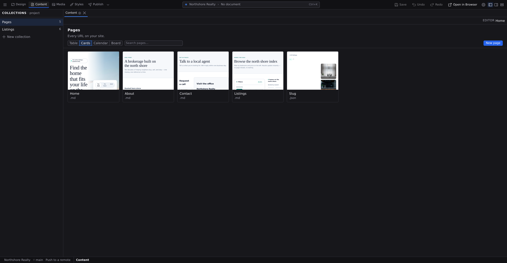

# The Content workspace

The Content workspace is where you browse and write what your site says: its pages, and the entries of every [content collection](/docs/studio/projects/content-types). Click **Content** in the Command Bar, or press :kbd[⌘2]. It opens on the collection you last looked at, or on **Pages** the first time.

## The Collections panel

The panel on the left lists **Pages** first, then every collection your project declares, in the order `project.json` declares them, each with how many entries it holds. A collection is named in words, so `project_tag` reads **Project tag**, and one of its items is a "project tag" (a collection named for the whole, such as `menu` or `gallery`, holds a "menu item" or a "gallery item"). Click one to show it.

- A collection's **saved grid views** are listed under it. Click one to open the collection's grid with that view applied. You save a view from the grid's **View** menu; see [Data grids](/docs/studio/data/grid).
- **+ New collection** at the foot opens **Add new** on **Collection**: a name, the fields each entry has, and whether each entry gets a page of its own. See [Content types](/docs/studio/projects/content-types).

While you are writing an entry, the panel lists that collection's entries instead, each with its thumbnail (the entry's first image field), its title, whether it is a draft and, in a [multilingual project](/docs/framework/site/i18n), the language it is written in. When the collection is filtered to one **Language**, the list keeps to that language. An entry's title is its `title` field, or its `name`, `label` or `heading` when the collection has no `title`, and its file name only when it has none of these. **‹ Posts** at the top takes you back to the collection, and **+ New post** at the foot adds another entry to it.

## One collection at a time

The middle of the window shows the collection you chose, under its title. The toolbar holds:

- the **view switch**: **Table**, **Cards**, **Calendar** and **Board**;
- **Search**, matched against each file's name and its path, so `2026` narrows to this year's posts and `hero` to a name;
- **Language**, on a [multilingual project](/docs/framework/site/i18n) whose collection holds more than one language;
- **Filter**, which narrows every view to one value of what **Board** groups by: a status (**Draft** or **Published**), or one value of a field, such as one category. It appears when that grouping has at least two values;
- **Edit in grid**, which opens the collection as a [grid](/docs/studio/data/grid), one row per entry (a collection only);
- **Fields**, which opens [Project Settings](/docs/studio/projects/settings) on this collection's fields (a collection only; pages have none);
- **New page** or **New post** (the collection's own word for one item), which opens **Add new** on that collection.

Each collection keeps its own view, search, filter and language. Pages in **Table** and Posts in **Cards** is a state you can leave and come back to.

Every control is a command too, so the toolbar is never the only way in: :kbd[⌘K] → **Content: Show Collection** shows a collection by name, and **Content: Set View**, **Content: Search Collection**, **Content: Show Language** and **Content: Rescan Files** are the rest. They are listed with everything else on **[Commands](/docs/studio/interface/commands)**.

:::doc-note
A collection lists its entry files, so a draft sits beside a published entry. Being a draft is a property of the entry: the switch, the pill on its tab and the project-wide **Include Drafts** perspective are covered in **[Content types](/docs/studio/projects/content-types#drafts)**.
:::

### A collection stored in one file

A collection whose `source` names one file, such as a CSV price list (`"source": "./content/pricing/prices.csv"`), lists that file's records: one entry per row under the header (or per object of a JSON array, or one entry for a JSON file holding a single object), named by its `Title` (or `title`, `name`, `label` or `heading`) column, with the other columns in the Table. Its count in the Collections panel and in the Site panel is its number of records.

Clicking a CSV record opens it in the [entry form](/docs/studio/projects/content-types#edit-an-entrys-fields): that one row's fields, typed by the collection's schema, under the record's title and its place in the file ("3 of 11"), with **Previous** and **Next** to step through the rows. The form edits the file's own grid, so :kbd[⌘S] saves the file (only the cells you changed are rewritten), :kbd[⌘Z] undoes a field, and **Edit in grid** shows the whole file with that row selected. **Edit in grid** in the toolbar opens the same grid. The grid is where you add and remove rows, so there is no **New** button and no right-click menu on a record. **Calendar** places each record on its own date column, as it places an entry file.

## Where a collection is published

Above a collection's list, one line says where its entries appear on your site:

- **Each post has a page at `/blog/:slug` using Post**: the collection has a template page, here `pages/blog/[slug].json`, and every entry is published at that address. **Design the post page** opens the template page in the Design workspace. In a multilingual project each language usually has its own template page: filtered to one language, the line names that language's page; showing all of them, it names every language's page in turn ("Each exhibition has a page in each language at `/exhibitions/:slug (en), /fr-ca/expositions/:slug (fr-CA)`"). **Design the exhibition page** opens the page of the language you have filtered to, or the default language's. An entry is written inside the template of its own language.
- **Entries have no page of their own**: no page in `pages/` expands over this collection. A page counts when its `$paths` names the collection (`contentType`), or when it lists its own URLs (`values`) and reads one entry of the collection by the route parameter, as a taxonomy page such as `pages/author/[slug].json` does. **Add one** writes `pages/<collection>/[slug].json`, the same page **Add new** writes when you create a collection with **Give each item its own page** on, bound to the collection's title, image and body.

Studio reads this from your pages rather than storing it: the template page is the page whose `$paths` names the collection, so the line can never disagree with what the site build publishes.

## Four views

All four draw the same scan, so switching view repaints. It never re-scans your project; the Table reads each page once for its template and status.

| View         | What it is good for                                                                                                                                                                                                                                                                                                                                                                                                                                                                                                                                                                                                                                    |
| ------------ | ------------------------------------------------------------------------------------------------------------------------------------------------------------------------------------------------------------------------------------------------------------------------------------------------------------------------------------------------------------------------------------------------------------------------------------------------------------------------------------------------------------------------------------------------------------------------------------------------------------------------------------------------------ |
| **Table**    | For pages, in the order your site matches their addresses: **Title** (the name the address gives the page, as the Site panel names it: Home, About, Post page, and Home (ar) for a page in a language folder), **URL**, **Template**, **Status** when some page is marked a draft, **Language** when pages come in more than one, and **Edited**. For entries: each entry's **Title**, its **Status** when it has one and its **Date** when the collection declares one, then up to six of the collection's own fields (a menu's Course and Price), **Locale** when entries come in more than one language, then its file. The densest way to find one |
| **Cards**    | Every page or entry with its title (or file name) underneath: an entry with a picture (its `cover`, or whichever field the collection declares an image) shows that picture, and anything else a live preview                                                                                                                                                                                                                                                                                                                                                                                                                                          |
| **Calendar** | Entries grouped by day, newest first: dated posts, in the order you published them                                                                                                                                                                                                                                                                                                                                                                                                                                                                                                                                                                     |
| **Board**    | One column per status (**Draft**, **Published**) when the collection has a draft workflow, otherwise one per value of a field the entries share (a menu's Course), otherwise one per folder, each with a count                                                                                                                                                                                                                                                                                                                                                                                                                                         |

Every column keeps a minimum width, and the title a readable one, so a collection with many fields scrolls sideways rather than squeezing its titles. A modification date is the day it was in your own time zone.

:::doc-note
The Table lists files; it does not edit them. Changing a name is a rename, not a cell edit, so renaming, duplicating and deleting live in the right-click menu below, where the confirmation can tell you what else is affected. To edit entries' fields in a spreadsheet, click **Edit in grid** in the toolbar, which opens the collection's [grid](/docs/studio/data/grid).
:::

**Calendar** places an entry on the date its own date field holds (a field the collection's schema types as a date, or one named `date` or `published`; a date written `6/3/2026` counts as well as `2026-06-03`). Otherwise it uses the day the file name starts with (`2026-04-12-spring-menu.md`), and then the file's modification time. A file with neither is listed under **No date** rather than parked on today. It draws the 60 most recent days and says how many older ones it left out.

**Board** groups by the first of the collection's fields that declares a fixed list of values, or else by the first field whose values repeat across entries, so a menu becomes Starters, Mains, Desserts and Drinks. A list field groups by each of its values, so a project tagged both Patios and Stone stands in both columns. A number or a date never groups a board: two entries with the same price are not a category. Entries with that field empty sit in a last column of their own. Board caps each column at 25 items and prints how many more there are. Both grouped views draw titles only. For the full list, switch to Table.

## Write an entry

Click an entry to open it. An entry with a body, such as a Markdown post, opens on the canvas in **Edit**, inside the template its pages are drawn in: the entry's own template if it names one, otherwise its collection page's, otherwise your project's default. A slim banner above the canvas says what that means:

> Writing mode: text and media are editable, the layout is locked · **Design the post page**

The header, the footer and everything else the template draws are shown, dimmed and locked, so you write in context without being able to break the layout. The button opens the collection's template page in the Design workspace, with the same words as the line above the collection. A collection with no page of its own names the template instead: **Edit the Base template in Design**.

The Inspector on the right shows the **Entry** tab while you write: the entry's **status** (a **Draft** switch, when the collection has a draft workflow), its **fields** as the collection's schema types them, the **URL** its page publishes it at, and the **file** it is stored in. The Element tab is there too, because writing still selects elements.

An entry with no body (a JSON entry is nothing but its fields, and a CSV record is one row of its file) opens in the [entry form](/docs/studio/projects/content-types#edit-an-entrys-fields) instead.

:::doc-note
Studio wraps an entry in its template's **layout**. A template page that draws its own wrapper around the entry (a hero over the entry's body, say) shows that wrapper when you preview the page itself, not while you write the entry.
:::

## Open, rename, duplicate, delete

Right-click any item for **Open**, **Rename…**, **Duplicate** and **Delete**. A page opens in the Design workspace; an entry opens where it is written. A duplicate lands beside the original with `-copy` on its name.

Rename and delete go through the same confirmations as the Files panel, and they carry the same counts: a rename tells you how many references Studio will rewrite for you, and a delete tells you how many stop resolving. See **[Before you delete, rename or convert](/docs/studio/projects/pages-layouts-components#before-you-delete-rename-or-convert)**.

Images, video, fonts and documents are not content: they live in the [Media workspace](/docs/studio/projects/media), and so does uploading.

## Big projects stay quick

The Content workspace renders what fits the window, not what is in the project: a 300-page site draws about forty cards, and the rest arrive as you scroll. A card's live preview is built the moment the card comes into view (never before), and a fixed number of rendered previews stay in memory however long you browse. Table, Calendar and Board draw text only, so they stay cheap by construction.

## When the list is short

A short list has more than one cause, and the Content workspace says which:

- **Scanning the project…**: the scan is still running. Nothing is claimed yet.
- **No posts yet.**: the scan finished and the collection is empty. The fix is **New post**.
- **No posts match "hero"**: your search matched nothing, with the collection's total beside it and a **Clear filters** button.
- **Nothing to show, and the scan did not finish**: Studio could not read one or more of your project's directories, so the list is incomplete rather than empty. It offers **Retry**.

That last one also shows up as a banner above the partial list, naming the first directory that could not be read, and as a Problem in the bottom dock with the same retry attached. A scan slow enough to look like a hang gets an **Activity** row while it runs. See **[Problems and progress](/docs/studio/interface/problems-and-progress)**.

:::doc-warning
An unreadable directory and an empty one mean very different things: one is a collection you have not filled in yet, the other is a listing you should not trust. If you see the incomplete banner, fix the directory (or press **Retry**) before concluding an entry is missing.
:::

**Content: Rescan Files** re-reads the project from scratch at any time. Studio also re-scans on its own after anything it creates, renames, duplicates or deletes, and after a file changes on disk.

## Next

- **[Content types](/docs/studio/projects/content-types)**: collections, their fields, entries and drafts
- **[Pages, layouts, and components](/docs/studio/projects/pages-layouts-components)**: which kind of file you want
- **[Media](/docs/studio/projects/media)**: where every image, video, document and font is uploaded, replaced and deleted
