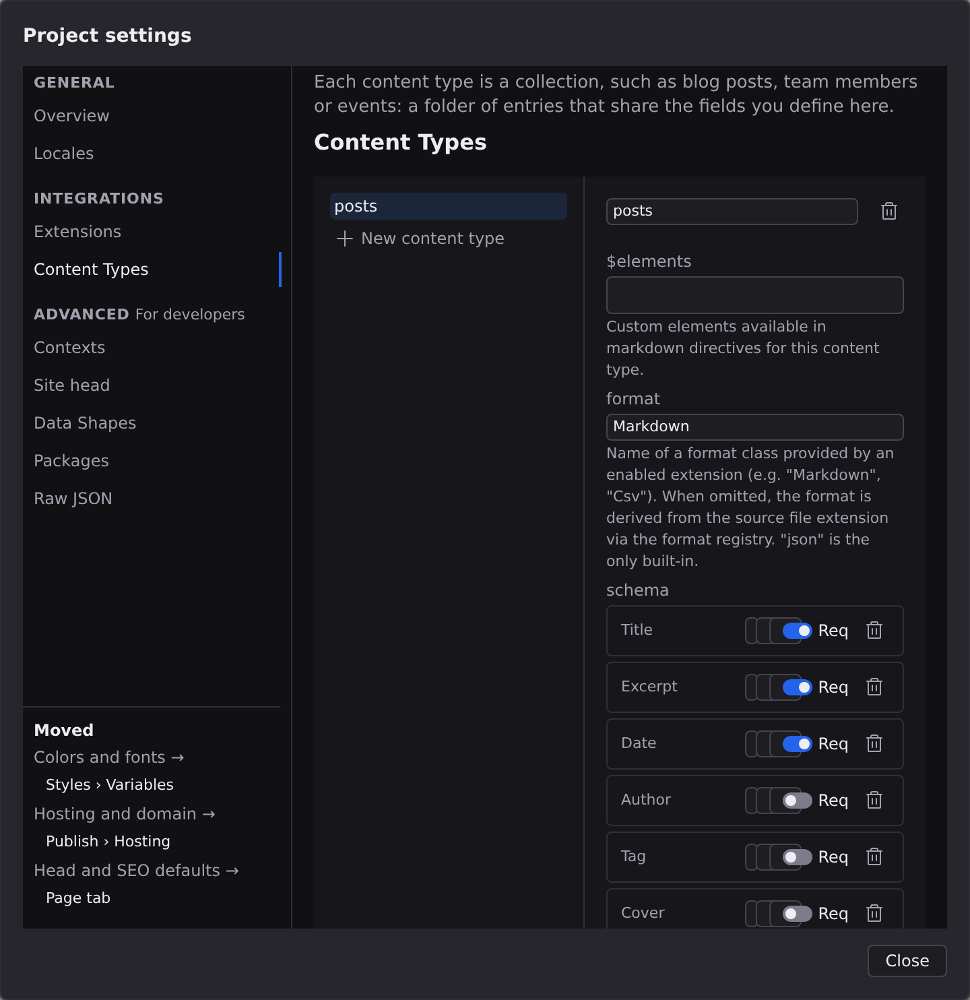

# Content types

Content types are your site's CMS schema. Each one describes a collection (blog posts, team members, projects) by naming the folder its entries live in, the file format they use, and the fields every entry carries. Once a type exists, Studio can create entries against it and draw their fields as a form.

The builder is a section of [Project settings](/docs/studio/projects/settings), listed under **Integrations** because the parser extension contributes it. Pick **Open Project Settings › Content Types** from the **Settings** menu in the Command Bar. You can also press :kbd[⌘K] and run **Open Project Settings**, or use the **⬢ menu** in the Command Bar, then choose **Content Types** from the section list: the section opens with one sentence on what a content type is, your types are listed on the left, and selecting one opens its editor on the right. Like every other section, what you change here is written to `project.json` as you make it.

## Create a content type

The quickest way is **Add new** (:kbd[⌘N], or :kbd[⌘⌥N] in a browser): choose **Collection** and type a name such as `Recipes`.

- **Each recipe has** offers the fields most collections start with: **Title**, **Image**, **Rich text** (the entry's body, when your project writes Markdown), **Date**, **Tags**, **Number** and **Link**. Title, Image and Rich text start chosen; click a chip to add or drop it. You can change the fields here afterwards.
- **Give each recipe its own page** (on by default) also creates the page every entry opens at, `/recipes/:slug`, using the template you pick. It is the same page a blog starter ships: the entry's title, image and body, bound to whichever entry the address names.

**Create collection** adds the `recipes` type to `project.json`, a `content/recipes/` folder with a first entry, and the page `pages/recipes/[slug].json`. The dialog says all of that before you click.

You can also start a type here, from scratch:

1. Click **New content type** at the bottom of the type list.
2. Type a name ("Blog Posts" becomes `blog-posts`) and click **Create**.

The new type starts with a matching source folder (`content/blog-posts/`) and an empty field schema, and is selected ready to edit.

## Source and format

- **Source**: the project folder entries are read from. The default matches the type's name; change it to point anywhere inside your project.
- **Format**: the file format entries use, by name (for example Markdown or Csv). Leave it empty and the format is worked out from each file's extension.

## Build the field schema

The fields you add here become the form every entry fills in. Each field row has:

- A **name**: click it to rename.
- A **type**: string (text), number, boolean (yes/no), array (a list), object (a group of sub-fields), or reference.
- A **format** for string and array fields (**image**, **date**, or **color**), which upgrades the field's editor: image fields get the [media picker](/docs/studio/projects/media), date fields a date, and so on.
- A **Req** toggle marking the field as required.

An **object** field opens a nested area where you add sub-fields the same way. A **reference** field gets a **Target** picker naming another content type, which is how a post points at its author. The trash icon deletes a field.

:::doc-tip
One field name is special by convention: a boolean called `draft` gives the collection the [draft workflow](#drafts) below.
:::

## Rename or delete a type

With a type selected, edit its name in the editor's header to rename it, or click the trash icon beside the name to delete it. Deleting the type does not delete the entry files in its source folder.

## Create an entry

Open **Add new** (:kbd[⌘N], or **New menu** in the [Content workspace](/docs/studio/projects/browse) with the collection showing), choose **Entry**, pick the collection, and type a name such as `Spring menu`. Studio writes `content/menus/spring-menu.md` and opens it where it is written: a Markdown entry on the canvas inside its template, with its fields in the Inspector's **Entry** tab ([below](#edit-an-entrys-fields)); a JSON entry in the entry form. Entries then appear in the Content workspace under their collection.

Two things make an entry different from a blank file: it is named with the collection's **own extension**, so the entry is actually matched by the collection it was created in, and its fields are **seeded from the schema**, so it is valid the moment it exists rather than being a pile of absent required fields. When the schema has a `title`, it starts as the name you typed.

**The Files tree knows about this too.** Right-click a content type's folder and choose **New File…**: because that folder belongs to a collection, you get the New Entry flow (the collection's extension and the seeded fields, opened where the entry is written) rather than a blank document. In a **subfolder** of it the format picker is locked to the collection's extension instead, because a document there is still one of its entries but the images and notes beside them are not; the picker's **Other…** row still creates those. What it will not accept is a document of a different format, which the collection would discover as an entry it cannot read.

A **localized** collection (a `{locale}` in its source) keeps one folder per language, so Add new asks which **Language** the entry is written in. It starts on the language the Content workspace is filtered to (or the language of the entry you are writing, from **+ New** in the entries list), else on the site's default, and the entry is saved in that language's folder: `content/exhibitions/fr-CA/night-tide.md`.

In a multilingual project a new **Collection** is localized too, with **One folder per language** checked: its source is `./content/<name>/{locale}`, its first entry goes in the default language's folder, and its own page is the default language's. Uncheck it for a collection whose entries are the same in every language, which is then served under every language's URLs.

An entry is also not something you can convert: **Convert Format…** is not offered inside a content type's folder, in either direction. Changing the format of one entry would remove it from the collection; the collection's format belongs to the type, and you change it here.

Seeded means:

- a field that declares a **default** gets that default;
- a **required** field with no default gets its type's empty value: `""`, `0`, `false`, `[]`, or `{}` for an object;
- an **optional** field with no default is left out of the file. The form still draws a row for it, because the form draws the schema, not the file.

## Edit an entry's fields

Open an entry from the [Content workspace](/docs/studio/projects/browse), or right-click it in the Files tree and choose **Open Entry** (the row is offered only for a file that belongs to a collection). Where its fields appear depends on whether it has a body:

- **An entry with a body** (a Markdown post) is written on the canvas inside its template, and its fields are the Inspector's **Entry** tab, beside its status, the URL its page publishes it at, and the file it is stored in. See **[Write an entry](/docs/studio/projects/browse#write-an-entry)**.
- **An entry that is only fields** (a JSON entry) opens in the **entry form**, on the same tab, so :kbd[⌘Z] and :kbd[⌘S] behave as they do anywhere else.

Both are the same form: your schema, drawn as one control per field, in the order the schema declares them.

- **Where the fields live depends on the format.** A Markdown entry keeps them in frontmatter above its body; a JSON entry _is_ its fields, with no body to separate. The form is identical either way, so you should not be able to tell from using it which shape the file has.
- **The field's type and format choose the control.** Text, numbers, yes/no switches, dates, colors and the [media picker](/docs/studio/projects/media) for image fields.
- **A reference field is a picker**, listing the entries of the collection it targets, so pointing a post at its author is a choice from a list, not an id you have to remember.
- **A required field the file does not have** is marked "Required — this entry does not have one." A required field that is present but empty is not an error: you have not done anything wrong by not having typed it yet.
- **Edits are ordinary document edits.** :kbd[⌘S] saves, :kbd[⌘Z] takes one back, and a collaborator sees the change as they would any other.

Open a file that belongs to no collection and the form says exactly that, and offers a button through to the Content Types section rather than drawing an empty form.

A Markdown entry's frontmatter is reachable while you write it on the canvas, too, from the Inspector's **Entry** tab, the one place an entry's fields are edited (the canvas shows the writing banner in place of the Document Header card). See **[Frontmatter and page metadata](/docs/studio/editing/frontmatter)**.

## Drafts

Give a type a boolean field named `draft` and its entries get a draft workflow:

- a **Draft** switch in the Inspector's **Entry** tab, and in the entry form's header;
- a **Draft** or **Published** pill on the document's tab, so the state is visible while you are looking at the tab strip and not only while you are looking at the form;
- the **Set Draft** command (:kbd[⌘K], **Set Draft**, then **on** or **off**), which writes `draft: true` or `draft: false` on the open entry;
- a **Draft** column in the collection's grid: right-click the collection's folder in the Files panel and choose **Edit Collection in Grid**, where every schema field is a column you can sort and group by. See **[The grid](/docs/studio/editing/grid)**.

**Include Drafts** (:kbd[⌘K], **Include Drafts**, **on** or **off**) sets whether Studio's content listings include entries marked `draft: true`. It is one setting for the whole project rather than one per list: whether you want drafts in view is a fact about you, not about the surface you happen to be looking at.

A collection whose schema does not declare `draft` shows none of this: painting "Published" on entries of a project that never defined the state would be inventing one.

:::doc-warning
Marking an entry a draft filters it out of Studio's own listings. It does **not** keep the entry out of a build: a page that queries the collection will still render it unless the page's own query excludes it. To keep entries out of the build for good, give the content type a `where` filter in `project.json`, such as `{ "draft": { "$ne": true } }`; see [Content collections](/docs/framework/site/content-collections#choosing-which-files-are-entries).
:::

:::doc-note
Studio stores your types in the `content` section of `project.json`, one entry per type, recording its `source` folder, `format`, and field `schema`. Pages query these collections to list and display entries; see [Site architecture](/docs/framework/site). Options that choose which files are entries, or say where each one is routed, are covered in [Content collections](/docs/framework/site/content-collections).
:::

## Next

- **[The Content workspace](/docs/studio/projects/browse)**: where entries are listed, created and written
- **[Project settings](/docs/studio/projects/settings)**: the rest of the configuration document
