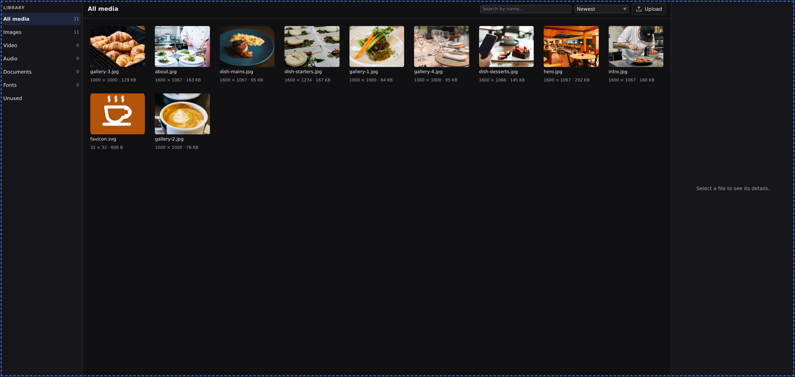
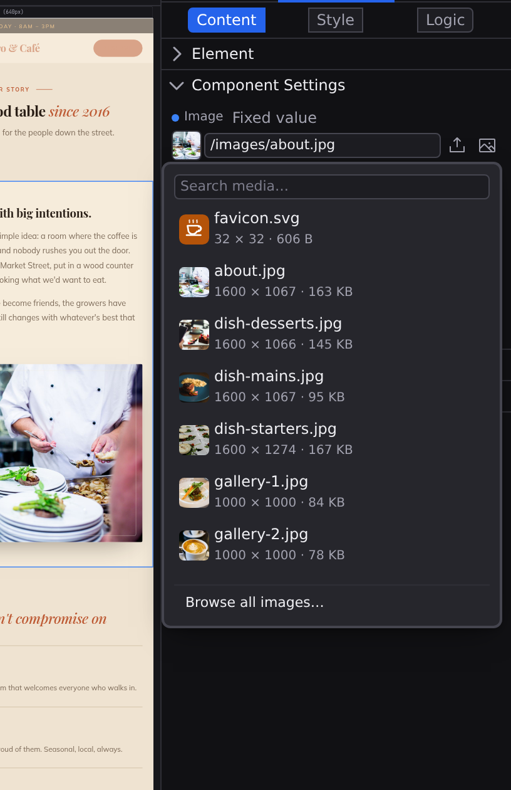

# Media

Your site's media (images, video, audio, PDFs, and fonts) lives in your project alongside everything else. The **Media** workspace is where you find it, add to it and tidy it up: click **Media** in the top bar, or press :kbd[⌘3]. You can also add media from wherever you already are: drag a file onto the page you are designing or onto a folder in the Files panel, or click **Upload** on any image field.

## The Media workspace

The Media workspace shows every media file in the project in three columns: filters on the left, a grid of tiles in the middle, and the selected file's details on the right. It lists everything under `public/` and every collection's `images/` folder, so a picture you uploaded to a blog post is here too.

- **Filters**: **All media**, **Images**, **Video**, **Audio**, **Documents** and **Fonts**, each with its count, and **Unused**, the files no page, component or entry refers to. Unused has no number until you choose it: Studio then asks the reference search about every file, one at a time, and the count appears when the last answer is in. A file whose search failed is never counted as unused. Saving, renaming or deleting a document asks again, so a picture you have just placed on a page leaves Unused.
- **Search and sort**: the search field matches a file's name or path. Sort by **Newest**, **Name** or **Size** (largest first).
- **The grid**: thumbnails load as their tiles scroll into view. Click a tile to select it, or :kbd[Tab] onto the grid, which selects the tile it lands on. Use the arrow keys to move the selection (:kbd[Home] and :kbd[End] go to the ends of a row, with :kbd[Ctrl] to the ends of the grid), and press :kbd[Enter] or double-click to open the file in its viewer.

The **Unused** filter appears only when your project's host can search references. A host that cannot is never shown a filter that would always answer "nothing".

:::doc-note
There is no **Missing alt text** filter and no tags yet. Alt text is written on each image element where it is used, not stored per file, and there is no tag store to filter by. Both are planned once they have somewhere to live.
:::

### The details pane

Select a file and the right-hand pane describes it:

- **A preview**: the picture, a player for video and audio, or a font set in its own face.
- **What it is**: its kind, its pixel dimensions once the picture has loaded, its size on disk, and when it was last modified. Anything Studio hasn't been told is left out rather than shown as a zero.
- **Site URL**: the address a document writes for this file, with a **Copy** button. A file at `public/media/hero.jpg` is referenced `/media/hero.jpg`, a string that is not its path, and writing the path instead is the commonest way an image goes missing from a page.
- **Used on**: every document that refers to the file, with a count each. Click one to open it.
- **Replace**, **Open in viewer** and **Delete**.

**Replace** swaps a file's contents and keeps its name. Pick the new file and Studio writes it over the old one at the same path, so every page, component and entry that uses it shows the new picture straight away, with nothing to re-link. It is the one way Studio ever writes over an existing file. The new file has to be the same type as the old one (a JPEG for a JPEG, an SVG for an SVG), because the address stays the same and a page asking for `hero.jpg` cannot show a PNG. To swap in a different type, upload it as a new file and point the pages at it.

**Delete** asks first, and says what it would break (see [Deleting media](#deleting-media) below).

## Upload into the Media workspace

Click **Upload** in the Media workspace's toolbar, or drop files anywhere on it. Uploads land in `public/media/`; the Upload button's tooltip names that folder before you press it, and there is no folder to choose. The first file you upload is selected once it arrives, so the details pane shows what you added. **Add new › Media** (:kbd[⌘N]) uploads to the same place and then shows you the Media workspace with the upload selected.

Only the kinds of file the workspace lists are uploaded: images, video, audio, PDFs and fonts. Drop a text file or a spreadsheet along with your pictures and Studio skips it and says which files it left out, rather than adding something you would never see here.

You can also run **Upload Media…** from the command palette (:kbd[⌘K]), which opens the same file picker.

## Drag onto the canvas

Drag an image from your desktop onto the page:

- **Onto empty space**: Studio uploads it and drops an image in at that spot. You'll see the same insertion line you get when dragging an element from the Insert palette.
- **Onto an image that's already there**: the picture is highlighted, and dropping swaps it for the new one. Nothing else about the element changes: its size, alt text, and styling all stay put.

Video, audio, and other files work too. A video becomes a `<video>` player, audio becomes an `<audio>` player, and anything else (a PDF, say) becomes a download link labelled with the filename. Drop several files at once and they land in order.

Media that is already in the project is in the **Media** section of the [Site panel](/docs/studio/interface#the-site-panel): drag a thumbnail onto the canvas and it lands as an image (or, for a document, a link) pointing at the file. Its **Open Media** link switches to the Media workspace.

:::doc-tip
Dropping onto a component that takes a single image (a card with a cover picture, for instance) replaces that picture, not the whole component. Dropping an image onto a video sets its poster frame, since a video's own `src` is the movie.
:::

## Choose media for a field

Studio asks for an image or file in several places: an image's **Content** tab, a frontmatter field, and the Icon and social-image fields in **[Search appearance](/docs/studio/editing/frontmatter)**. Every one of them has a browse button and an **Upload** button.

The browse button opens a compact list: a search box over the project's media, matched on name or path, with a thumbnail for every image. A field that holds a picture lists only images. It opens above whatever surface it was called from, so it works the same in a panel and in a window like Search appearance.

Its last row, **Browse all media…** (**Browse all images…** for a picture field), opens the Media workspace's own library in a dialog: the same filters, search and grid. Double-click a file, or select it and click **Use**, to fill the field in. **Cancel** leaves the field as it was. You can upload into the dialog too, and the new file is selected ready to use. It lands where the field's own **Upload** would put it (see [Where your files go](#where-your-files-go)), so a picture chosen for a blog post stays with that post.

**Upload** beside the field picks a file, adds it to the project and fills the field in for you.

## Drag into the Files panel

Drag files onto any folder in the Files panel and they upload into that folder. The folder highlights as you hover it, and expands once the files land. Dropping onto a file puts the upload beside it, in the same folder. Dropping onto empty space in the panel puts it at the top level of your project. (Files is a developer panel: run **Show Files** from :kbd[⌘K] to open it, or turn on **Show developer panels** in Preferences › Appearance to keep it on the rail.)

You can also right-click a folder and choose **Upload Files…** to pick from a dialog instead.

## Where your files go

When you don't pick a folder yourself, Studio decides from what you're editing:

| You're editing             | Files land in                  | Referenced as       |
| -------------------------- | ------------------------------ | ------------------- |
| A content collection entry | `content/<collection>/images/` | `./images/hero.jpg` |
| Anything else              | `public/media/`                | `/media/hero.jpg`   |

Everything in `public/` is served from your site's root, so `public/media/hero.jpg` becomes `/media/hero.jpg` on the published site. `public/media/` is only the default: a file you put anywhere else under `public/` is published and listed exactly the same. Media kept beside a content entry travels with it, which is useful when a blog post's pictures belong to that post rather than to the site as a whole. The folder layout is documented in [Site architecture](/docs/framework/site).

A post's own pictures are written the way any markdown editor expects (`./images/hero.jpg`, relative to the post), so the file still reads correctly outside Studio. On your published site those become `/content/posts/images/hero.jpg`, and the canvas previews them at that same address, so what you see while editing is what visitors get.

A **translated** collection keeps each language's pictures apart the same way. A collection sourced from `content/posts/{locale}` publishes each locale's folder separately, so a French post's `./images/hero.jpg` is `/content/posts/fr/images/hero.jpg` and its English translation's is `/content/posts/en/images/hero.jpg`: two different pictures at two different addresses, which is usually the point.

:::doc-note
Some hosts cap the size of a single upload. When yours does, Studio refuses an oversized file before sending it and says what the limit is, so a large video fails in a moment with a number rather than after a long wait.
:::

:::doc-note
Uploads never overwrite. If a file of the same name is already there, the new one becomes `hero-1.jpg`, then `hero-2.jpg`, and so on. The original is left alone. A batch doesn't collide with itself either. The only way to write over a file is **Replace** in the Media workspace, which you ask for by name.
:::

## Open a media file

Click a thumbnail in the Site panel's **Media** section or an image in the Files panel, or choose **Open in viewer** (or double-click a tile) in the Media workspace, and it opens in a tab of its own in the **Media** workspace, the same as a page or a component and keyed by the same path. What that tab shows depends on the file: an image at full size, a video or audio file with playback controls, a font set as a specimen at five sizes, a PDF embedded. A format Studio has no viewer for says so plainly and notes that the file is still in the project and still builds.

Beside the file, the same three things the Media workspace's details pane shows:

- **What it is**: its kind, its pixel dimensions once the image has loaded, its size on disk, and when it was last modified. Anything Studio hasn't been told is left out rather than shown as a zero.
- **How to reference it**: the URL a document actually writes for this file, with a **Copy** button. This is worth having in front of you, because a file at `public/hero.jpg` is referenced `/hero.jpg`, a string that shares no part of its path, and writing the path instead is the commonest way an image goes missing from a page.
- **Used by**: every document that references it, with a count each. Click one to open it.

The viewer is read-only. Replacing and deleting a file are in the Media workspace's details pane; renaming and revealing one belong to the Files panel, where you already do them for everything else.

:::doc-tip
This is the fastest way to check what an [imported site](/docs/studio/projects/create) actually brought in. Open the Media workspace and click through the grid (or open `public/assets/images/` in the Files panel): you'll see the real dimensions of every asset the crawl downloaded, and which of your new pages uses each one.
:::

## What Studio knows about a file

A tile in the Media workspace and a row in the media picker carry a one-line caption as soon as Studio knows the numbers: `1200 × 800 · 84 KB`. Both halves are read from work already done, so a caption never costs a second download: the size comes from the directory listing that built the list, and the pixel dimensions from the thumbnail once the browser has decoded it.

A fact Studio doesn't have is left out of that line rather than filled in with a placeholder. A file whose size the listing didn't report shows only its dimensions; an image whose thumbnail hasn't loaded yet shows only its size. `0 × 0` is something a real file can nearly be, so it is never used to mean "we didn't find out".

## Deleting media

Deleting a picture is the one media gesture that can break pages you aren't looking at, so the confirmation says what it breaks **before** you press Delete. The count is resolved while the dialog is being built, never filled in after you've already answered it.

The dialog states how many references, in how many files, stop resolving, and that those files themselves stay on disk with their references left dangling. When nothing points at the file, it says so in its own words: _nothing else in this project refers to it_.

:::doc-warning
A count Studio could not produce is reported as **unknown**, never as zero. If the reference search fails, the dialog says the references could not be counted and that this may break more than it appears to. An unanswered question and an answer of "nothing" are different facts, and only one of them makes a delete safe. On a backend with no reference search at all, the dialog carries no count line rather than one implying a number it doesn't have.
:::

**Rename** is not a delete and doesn't read like one: its dialog states how many references will be **rewritten automatically**, because the rename repairs what the delete would break.

Studio finds those references wherever they are written. An image is referenced as a site URL (`/images/hero.jpg`), and the same file might be named by a page's `src`, by a component property you filled in on the canvas, by a content entry's front matter, or by the social card in your project settings. All of them count, and all of them are rewritten when the file moves. If the file leaves `public/`, the rewritten reference follows it, and Studio picks the form the published site will actually serve.

:::doc-note
A CSV collection is a data source Studio loads entries from, not a document it round-trips, so it is never rewritten wholesale. A reference in one is still repaired: Studio replaces that cell's text and leaves the rest of the file exactly as you wrote it. Where a reference genuinely cannot be updated (a file that will not parse), the rename reports a **warning** naming the file rather than a plain success. The same applies when you drag a file to a new folder.
:::

## What the build does to images

You only ever upload one copy of an image, at full quality. When your site is built for publishing, each image is optimized automatically: the build generates multiple sizes and modern formats (WebP, AVIF) and wires them up so every visitor's browser downloads the smallest version that looks sharp on their screen. There is nothing to configure in Studio. The pipeline is described in **[Site architecture](/docs/framework/site)**.

## Next

- **[The interface](/docs/studio/interface)**: the five workspaces and how to move between them
- **[Publish](/docs/studio/publish)**: how the optimized site goes live
