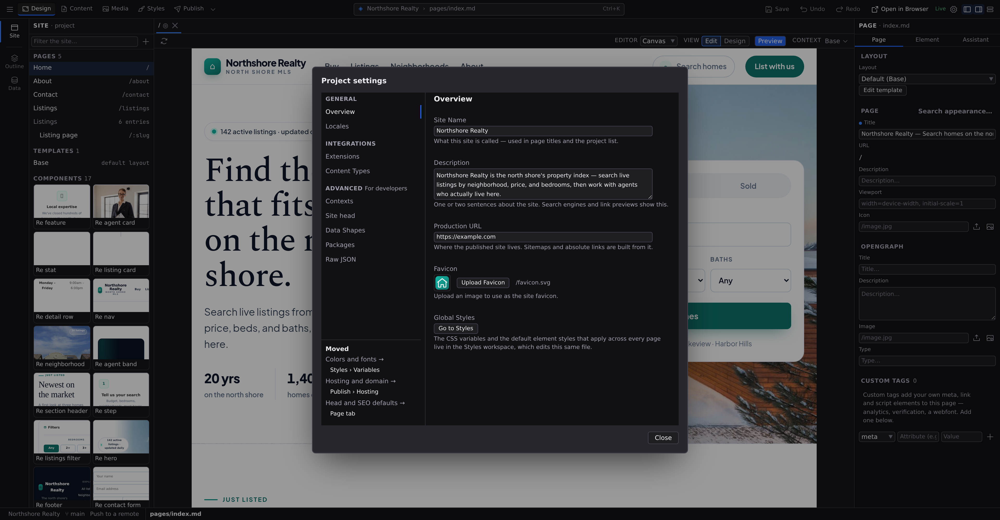

# Project settings

Everything that applies to your whole site rather than one page (its name and address, its languages, its extensions, its packages) lives in your project's configuration, the `project.json` file at the root of the project. **Project settings** is the dialog that edits it. It opens over whatever you are doing, in any workspace, and closing it puts you back exactly where you were.

Open it from the **Settings** menu at the right of the Command Bar: **Open Project Settings**, whose submenu lists every section in the dialog's order, with a divider where each group starts, so you can land on the one you want. It is also on :kbd[⌘⇧,], on :kbd[⌘K] as **Open Project Settings**, and in the **⬢ menu** in the Command Bar. (:kbd[⌘,] is the other half of the pair: **Preferences**, which configures the app rather than this project.)

## Finding your way around

The sections are listed down the left in three groups:

- **General**: Overview and Locales, the things every site sets.
- **Integrations**: Extensions, and every section an extension adds, such as Content Types, Data Tables, Authentication, Connections, Site Search and Feeds.
- **Advanced**, marked _For developers_: Contexts, Site head, Data Shapes, Packages and Raw JSON. Most sites never need them.

Click a section to show it, or reach a group's list with :kbd[⇥] and walk it with :kbd[↑] and :kbd[↓]. Each group is one stop for :kbd[⇥], so moving from General to Advanced is two presses. The dialog opens with the keyboard on the section you are looking at, and it remembers that section: open Project settings again later in the session and you land where you left off.

Press :kbd[Esc] or **Close** to dismiss it. The keyboard goes back to whatever you opened it from.

:::doc-note
Under the list, **Moved** names what used to be here and where it went: **Colors and fonts** to the **Variables** view of the **Styles** workspace, **Hosting and domain** to **Publish › Hosting**, and **head and SEO defaults** are also on the **Page tab** in Design (they are still editable under **Advanced › Site head**). Each one's button closes the dialog and takes you there; the Page tab button also opens the Inspector on its Page tab. The build adapter's picker is there, under **How it is built**.
:::

## Changes save as you make them

There is no Save or Apply button, because there is nothing to confirm: every section writes `project.json` the moment a change is complete, such as when you leave a field or flip a switch.

- **A failed write is visible.** If the file cannot be written (a read-only project, a full disk, a backend that has gone away), the change is not quietly dropped. Studio raises a problem naming `project.json` in the [Problems list](/docs/studio/interface/problems-and-progress).
- **An edit that changes nothing writes nothing.** Re-committing a field's existing value leaves the file untouched, so your project's diff only ever shows what you actually changed.
- **An edit that changes one field changes one line.** The file is written back in the layout it was read in, the same way [every document is saved](/docs/studio/interface/tabs#studio-saves-only-when-you-do), so a `project.json` your formatter keeps tidy stays tidy through a settings change. When the [assistant](/docs/studio/ai/chat) rewrites `project.json`, the layout it wrote is the one the next settings change keeps.
- **A section that cannot be shown says so.** If a section fails to load, the dialog says which one and why in the space the section would have used, rather than showing an empty column.

:::doc-tip
`project.json` is also a document you can open: **[Project Styles](/docs/studio/design/stylebook)** in the Styles workspace edits its element defaults (the **Elements** view) and its [design tokens](/docs/studio/design/tokens) (the **Variables** view), and its **Code** view shows the raw file. While that tab is open, a change made here is a step in its history, so :kbd[⌘Z] in that tab takes it back. Inside the dialog :kbd[⌘Z] reaches only the text field you are typing in, because the dialog is modal: to take back a change it has already saved, close it and undo from that tab.
:::

## Overview

What the site _is_:

- **Site Name**: what the site is called. This is the name you gave it when [creating the project](/docs/studio/projects/create), and this is where you change it afterwards. It can't be left blank.
- **Description**: one or two sentences about the site, used by search engines and link previews. Studio stores it as the site-wide `<meta name="description">` tag, so it also shows up in the **Site head** section; clearing it here removes the tag.
- **Production URL**: where the published site lives, as a full address starting with `http://` or `https://`. Sitemap generation is switched on by having one, and absolute links are built from it. Clearing the field turns the sitemap back off.
- **Favicon**: the site-wide `<link rel="icon">` tag, so it also shows up in the **Site head** section. Click **Upload Favicon** and pick an image; Studio saves it in `public/` (as `favicon.svg`, `favicon.png` or whatever its type is) and points the tag at it. The current icon shows beside the button.
- **Global Styles**: **Go to Styles** closes the dialog and switches to the Styles workspace (:kbd[⌘4]), where the CSS variables and default element styles live with the canvas beside them. See **[Project Styles](/docs/studio/design/stylebook)**.

A value the section refuses (a blank name, an address that isn't a full URL) is reported under the control that caused it, and the stored value stays as it was.

## Locales

The languages this site is published in. Add a [BCP 47](https://www.rfc-editor.org/info/bcp47) tag (`fr-CA`, `ar`, `de`), pick which one is the default, and choose whether the default language's pages sit at the bare URL (`/about`) or under a prefix like every other (`/en/about`).

Tags are checked as you type by the same parser the build uses, so a tag this field accepts is one that builds: `en_US` is refused here rather than discovered later. Declaring a second language is what turns on every other language surface in Studio. See **[Languages](/docs/studio/interface/languages)**.

## Extensions

Extensions add what Jx does not do on its own: content collections, site search, feeds, sign-ins and databases. Each one is a row with a switch, and the switch is the whole gesture.

- **Available** lists what your setup can run. Turning one on installs its package first if you do not have it, then enables it. The row says so before you click.
- **Installed** lists extensions already among your project's dependencies, including any third-party ones.
- **Named in project.json** lists anything your configuration asks for that Studio could not describe. You can still turn those off, which is what you usually want.

Each row names the settings sections the extension owns. Those sections appear under **Integrations** as soon as the change is saved, so a section an extension contributes shows up without reloading Studio, and disappears again when you turn it off.

**Turning an extension off leaves its package installed.** Turning it back on is then instant, and nothing about your pinned version changes. To remove the package itself, use the delete button on its row, which is offered only once the extension is off: deleting the package while your configuration still names it would break the next build.

:::doc-note
An extension has to be two things at once: a dependency your project has installed, and a name in your configuration. That is why the switch does both. If a row warns that an extension is named but not installed, turning it off and on again installs it.
:::

## Sections added by extensions

Extensions contribute their own sections, listed under **Integrations** after Extensions. **Content Types**, where you model your site's content, arrives this way from the parser extension and has its own page: **[Content types](/docs/studio/projects/content-types)**. **Connections** arrives from the connector extension: **[Connections](/docs/studio/data/connections)**. Turning an extension off in **Extensions** takes its section away again. An extension can ask for its section to be listed under General or Advanced instead (`group` in its `$studio.settings` block; see [Project sections and settings](/docs/extending/extensions/project-sections#studio-settings-studiosettings)).

A control in one of these sections that opens a tab, such as **Open Data Grid** in Data Tables, closes the dialog first, so the tab it opens is the one you see.

## Contexts

The conditions your pages are rendered under, and the only place they are defined:

- **Base width**: how wide the Base canvas renders when no other context applies.
- **Size breakpoints**: width conditions like `(max-width: 768px)`. Each one gets its own canvas panel in Design view. See **[Breakpoints](/docs/studio/design/breakpoints)**.
- **Colour schemes**: a Light/Dark picker that writes the `prefers-color-scheme` query for you. Declaring one turns on the **Auto / Light / Dark** control in the pane's context bar.
- **Feature queries**: anything else a media query can ask, such as reduced motion, print, hover, orientation. These become toggles in the context bar rather than canvas panels.

Name a context in plain language; Studio derives the stored name ("Wide screen" becomes `--wide-screen`). Each change is schema-checked before it is written, and a refusal (a duplicate name, an empty query) appears under the control that caused it while the stored value stays as it was.

:::doc-note
The check looks at the whole `project.json`, but only holds you responsible for what your edit changed. If the file already had a problem, such as a key from an extension you removed or a key something else wrote, that problem is reported once at the top of the section, naming the key, and your edit still saves.
:::

The context bar's **Context** popover only _chooses_ among what is defined here; its **Manage contexts…** footer opens this section, as do the breakpoint and colour-scheme labels in the Style tab, so you can add a breakpoint without losing your element selection.

## Site head

What goes into every page's `<head>`, the invisible part of a web page that loads fonts, styles, and services:

- **Google Fonts**: type a font family name and press :kbd[Enter] or click **+ Add** to load it across the whole site. Loaded fonts are listed with a delete button each.
- **Head**: add a **Link** (external stylesheet), **Meta** (page metadata), **Script**, or **Style** entry and fill in its fields. Script and Style entries get a text box for their body, which is where an analytics snippet or a custom style block goes.

## Data Shapes

Reusable descriptions of a piece of data (an API response, a shared record type) that other parts of the project can refer to. A data shape uses the same visual field builder as content types: named fields with a type, an optional format, and a required toggle. **New Data Shape** adds one; pick a shape on the left to edit its fields, and a **reference** field gets a picker naming one of your content types. Most sites never need this section; for modeling your content itself, use **[Content types](/docs/studio/projects/content-types)** instead.

## Packages

The npm packages your project uses, as a table of name, current version, and latest version:

- **Latest** is that package's newest version on npm. Every row carries one, whether or not you're behind, and Jx's own packages are treated the same as any other. A row reads `—` only when there's no npm version to name: a local or workspace package, or a lookup npm didn't answer.
- Type a package name and click **Add** to install one.
- A refresh icon appears on any row that's actually behind, and never on one you've pinned ahead of npm on purpose. **Update all** takes every behind row to its own latest at once.
- **Reinstall** re-installs everything from scratch: the fix-it button if packages ever end up in a bad state.

Adding packages and choosing which of their components your site uses is covered in **[Dependencies and imports](/docs/studio/projects/dependencies)**.

## Raw JSON

The whole of `project.json` exactly as it is saved. **Edit as code** closes the dialog and opens that same file in the Code editor, in the Styles workspace, where it has one undo history and one unsaved-changes flag like any document. **Back to Variables** (or **Back to Elements**) at the top of the pane returns you to the view you were last in.

:::doc-note
Every section edits `project.json` at the root of your project, the same file the New Project modal first wrote. The full shape is documented in [Site architecture](/docs/framework/site).
:::

:::doc-note
`project.json` is not shared through [collaboration](/docs/studio/publish/collaboration) sessions. It configures your copy of the editor and is edited from surfaces that are not the canvas, so each person's project configuration stays their own.
:::

## Next

- **[Content types](/docs/studio/projects/content-types)**: model your content in the Content Types section
- **[Dependencies and imports](/docs/studio/projects/dependencies)**: packages and component imports in depth
