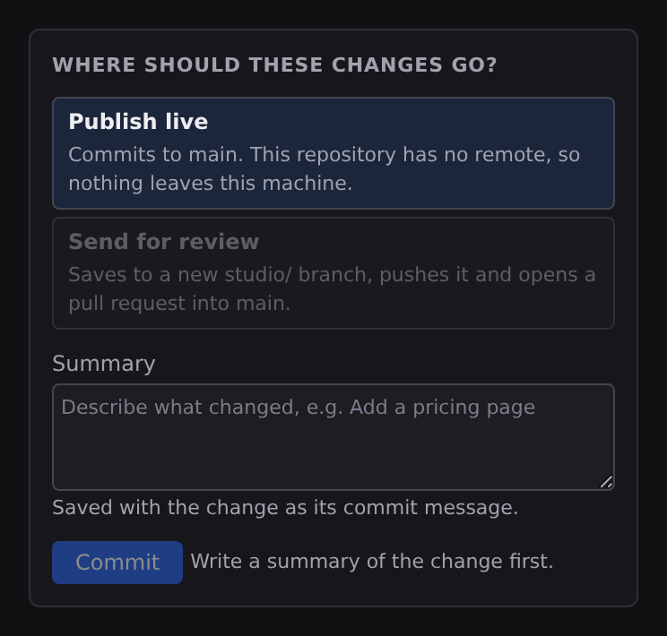

# Publish

Shipping a Jx site is part of the Studio flow, with no terminal and no separate deploy tool. It happens in the **Publish** workspace, the last tab in the Command Bar (:kbd[⌘5]), which counts your unpublished changes. The one boundary worth knowing up front: **Studio publishes your code; it doesn't build the site.** Studio's job ends when your files reach your repository and your provider has been told about it; the build itself happens on your host.

## How it goes live

1. In **Publish › Review changes**, every change is included the first time it shows up. Uncheck any file you want to leave out of this publish (it stays out until you check it again), write a one-line summary, and choose where the changes go.
2. Click the button under the summary. Its words say what it will do: **Publish live** when a host is connected, **Commit and push** when there is a remote but no host, **Commit** when the project has no remote yet, **Send for review** for a pull request.
3. The push wakes your host (or CI), which builds the project into plain HTML, CSS, and a little JavaScript, and serves it from a CDN. Your site is live.

**Quick publish.** The small arrow beside the Publish tab opens a dialog with the change count, the first few files, the destination, a summary field and one line of checks. **Publish now** takes every change to the destination you picked; **Review all** opens Review changes instead, where you can leave a file out.

**How you hear about it.** Anything that takes a while runs as an **Activity** in the Bottom dock, with its steps ticked off in order and its log underneath (creating the repository, adding the remote, pushing, waiting on the host), and the same steps show in **Publish › Deploys** while they run. Nothing about that is transient once it goes wrong: a push the remote refused goes on the **Problems** list, carrying the host's own error and the activity's log, and stays there until you deal with it. See **[Problems and progress](/docs/studio/interface/problems-and-progress)**.

Because every Jx file is plain JSON or Markdown, each publish is a clean, reviewable set of changes: no binary blobs, no database dumps.

## Where your changes go

Review changes and the quick publish dialog both offer two destinations, and each says in one sentence what choosing it does:

- **Publish live** commits what you included to the branch you are on, then ships it. With a host connected it pushes and asks the host what it built; with only a remote it pushes; with neither it commits, and says nothing leaves your machine.
- **Send for review** saves the change to a new branch named after your summary (`studio/add-a-pricing-page`), pushes it, and opens a pull request into the branch you were on. Once you have typed a summary, the choice names the branch it will create. It needs a host that can open pull requests. Where yours can't, the choice is drawn disabled with that reason, rather than pushing a branch that opens nothing.

:::doc-note
In Jx Cloud, every commit lands on GitHub as you make it, and each branch opens in a session of its own. So Send for review there opens the pull request from the branch you are on into the repository's default branch. On the default branch itself the choice is disabled, because a commit there would already be live: create a branch under **Publish › Branches** first, then send it for review from there.
:::

## The four views

- **Review changes** is the change list, grouped by the part of the project each file belongs to, with a checkbox per file, **Before and after** to see what changed, and **Discard**. Beside it are the checks, the destination, the summary and the publish button. A comparison opens in place of the list, and **Back to Publish** at the top of the pane (or :kbd[Esc]) closes it and brings the list back, with the keyboard on the change you compared, since the Publish workspace shows no tab strip. See **[Source control](/docs/studio/publish/source-control)**.
- **Deploys** is the live site (its address and its latest deployment), any deploy running now with its steps, every deployment your host reports, and the branch previews: the deployments built from a branch rather than for production. The address is the one your host reports, or else the **Production URL** in Project Settings › Overview. Until a host is connected, Deploys offers **Set Up Publishing** rather than **Deploy**.
- **Branches** lists your branches, with **Switch** on every one but the current, which shows how far ahead or behind its remote it is. **New branch** asks for a name and creates it from the one you are on.
- **Hosting** is where the site is published from and to: where the project is saved (git, and the GitHub connection), where it is hosted (Jx Cloud or your own Cloudflare account), how it is built (the build adapter) and its address (the host's, or the Production URL you set), with the deploy checklist underneath. **Open Deployment Dashboard** appears once a host is connected.

## The checks

Review changes lists two checks above the destination, and the quick publish dialog folds them into one line:

- **The next deploy step**, from the checklist below, with the button that fixes it.
- **Does the site build**, where your host can build it. **Check build** runs a build of the changes as they stand and reports the page count or the first error. A check run before you changed something else is shown as not run, rather than as passed.

Each check starts with an icon for its state: a tick when it passed, a warning when there is something to do, a question mark when it has not been checked yet, and a cross when it failed. A screen reader reads the state out in words. The steps of the deploy checklist are marked the same way.

## What's missing, before you start

Publishing is a chain: the project is tracked by git, it has a remote and the remote is current, a provider is connected, and something has actually deployed. Each link is a different action, so Studio keeps the whole chain in one place: the **Deploy checklist**, in **Publish › Hosting**, and also in the **Activity** tab of the Bottom dock (:kbd[⌘J] / :kbd[Ctrl+J]), beside the long operations, because a deploy is one.

Four steps, in the order they have to be done, each ticked off or explained:

| Step                            | Satisfied by                                |
| ------------------------------- | ------------------------------------------- |
| **Track this project with git** | **Initialize Repository**                   |
| **Push to a remote**            | **Create GitHub Repository**, then **Push** |
| **Connect a deploy provider**   | **Set Up Publishing**                       |
| **Deploy**                      | **Deploy**                                  |

Every step carries the command that satisfies it as a button, rather than a sentence telling you to go and find one. The button wears that command's own name, so it's disabled with a reason when it isn't available yet. A step that's done says what is true now (the branch you're on, the Pages project you're connected to); a step that isn't says what satisfying it buys you.

:::doc-note
A step Studio can't answer says so with a **?** rather than guessing. "Nothing has deployed" and "nobody has asked Cloudflare" look the same from inside the app, and a checklist that renders the second as the first would tell you to redo a deploy that already worked.
:::

The **status bar** carries the same chain in 24 pixels: its project field shows the **next blocking step** as its label, so the item both explains what's missing and fixes it when you click it. With the chain whole it reads **Deployed**, and clicking it opens your provider's dashboard. The branch item beside it opens the Publish workspace.

## The build adapter

The **deployment adapter** tells the build how to package the output for your target: Static, Bun, Node, Cloudflare Workers, or Cloudflare Pages. It isn't a creation-time decision: set it whenever you know where the site is going, from the **How it is built** picker in **Publish › Hosting**. Switching hosts means switching the adapter; your pages, components, and content stay the same.

Every page is built ahead of time, so what the CDN serves is finished HTML however the site is put together. Pick one of the non-Static adapters and the same build writes a small worker beside those files for your host to run. That worker is what answers the `/_jx/*` routes behind a database, sign-ins, or server functions. A database, sign-ins or server functions make an adapter mandatory: the build stops with an error on **Static**. **[Build output and adapters](/docs/framework/site/deployment)** lists what each adapter emits.

## The Publish commands

Four commands are in [Quick Access](/docs/studio/interface/quick-access) under **Publish**, always listed and each disabled with the one sentence that says why:

- **Quick Publish** opens the quick publish dialog. Needs a project tracked by git.
- **Set Up Publishing** opens the provider connection flow. Needs a platform that can reach the Cloudflare API; see **[Cloudflare Pages](/docs/studio/publish/cloudflare)**.
- **Deploy** pushes the current branch and then asks your provider what it made of it. Needs a repository with a remote and a connected provider. It doesn't commit for you: publish from Review changes to commit and deploy in one step.
- **Open Deployment Dashboard** opens the connected Pages project on Cloudflare.

**Go to Publish** (:kbd[⌘5]) opens the workspace on the view you left it on.

**Deploy runs as an Activity, not a toast.** The row shows its two steps (pushing, then asking for the deployment) with the log underneath, and it's honest about which one it's on: it waits for the deployment _record_, which appears within seconds, not for the build, which takes minutes. If the push fails, the failure becomes a Problem that outlives the operation, carrying the log and a recovery button: **Push**, the real command, so it can be run straight from the row. If nothing has been reported yet when the wait is over, the activity says exactly that instead of claiming a result.

:::doc-note
Rolling a deployment back is not in Studio yet: no host API is wired to it. Use your host's dashboard (**Open Deployment Dashboard**) to promote an earlier deployment.
:::

## The surfaces

- **[Source control](/docs/studio/publish/source-control)**: Review changes and Branches, where you include and compare changes, sync, branch, and read the history.
- **[GitHub](/docs/studio/publish/github)**: connect your GitHub account and publish a brand-new project as a repository in one flow.
- **[Cloudflare Pages](/docs/studio/publish/cloudflare)**: connect a provider so every push builds and publishes on its own.
- **[Redirects](/docs/studio/publish/redirects)**: keep old URLs working when a page moves, checked for chains, loops and rules a real page shadows.

## Next

- Understand the build and routing in **[Site architecture](/docs/framework/site)**
