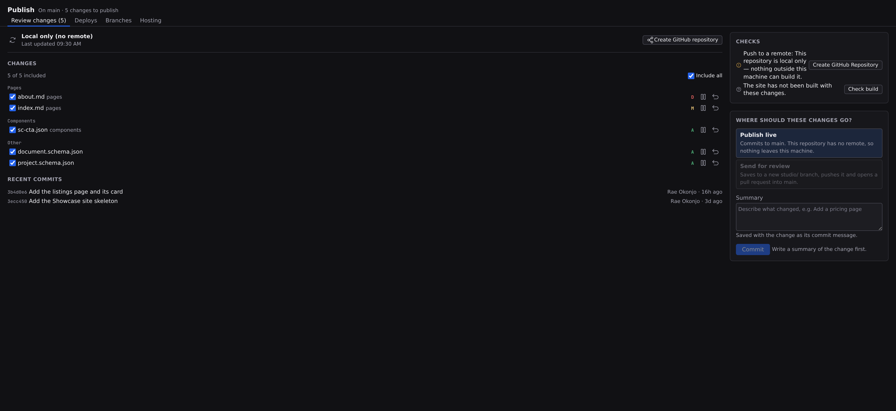

# Source control

Source control is Studio's built-in git client: it records your work as commits and keeps your copy of the project in sync with its repository. It lives in the **Publish** workspace (:kbd[⌘5]), whose tab in the Command Bar counts the files that have changed: **Review changes** is the change list and the publish card, and **Branches** is the branch list. The count and the change list are about the project, so they stand whether or not a document is open.

If the project isn't tracked by git yet, Review changes explains what a repository buys you and offers **Initialize Repository** to start tracking it. Once it is, **Create GitHub repository** puts it on GitHub; see **[GitHub](/docs/studio/publish/github)**. Projects created from the [New Project wizard](/docs/studio/projects/create) are already tracked, so you'll only meet this on a folder that came from somewhere else.

A project copied into a folder that another repository ignores (a scratch copy inside a larger checkout, say) counts as not tracked too. Studio never publishes, switches branches or syncs in the repository around it, because none of the project's files could be committed there. A site that is a tracked folder of a larger repository is tracked as usual.

With no project open at all, it says what publishing is for and offers **Clone Git Repository** where the platform supports it.

## Review your changes

**Changes** lists every changed file, grouped the way the site is organized: **Pages**, then each content collection by name, then **Components**, **Layouts**, **Styles**, **Media** and **Other**. A new folder is listed file by file, so the count is the number of files from the start. Each row shows a checkbox, the file's name and folder, and a status badge: **M** for modified, **A** for added, **D** for deleted, **U** for a brand-new untracked file.

- The checkbox **includes** the file in your next publish, and clearing it leaves the file out. A change is included the first time Review changes shows it, so an untouched change set reads "5 of 5 included"; a file you clear stays out until you check it again, and a file that changes for the first time after that comes in checked. **Include all** at the top checks or clears every row, and "4 of 5 included" says where you stand. Including a file is staging it, so what you see is what git will commit.
- **Before and after** on a row shows what changed since your last commit: it opens the file's **Diff** editor at full pane size, in the Publish workspace. Put it in a [second pane](/docs/studio/interface/tabs#two-panes) with :kbd[⌘\] and the review sits beside the page it is about, both live.
- Every row opens, whatever kind of file it is. A page or a component opens as a picture of the change; a stylesheet, a script or a config file opens as text. Deleted and brand-new files open too, with one side empty.
- **Discard** on a row throws its changes away. Studio asks for confirmation first. An untracked file has nothing to go back to, so its Discard is disabled rather than offering to throw the file away.

:::doc-warning
**Discard** permanently throws away a file's changes since the last commit. There is no undo beyond the confirmation dialog.
:::

## Read a change

The Diff editor compares your working copy against your last commit. It shows the change two ways, and the switch above the comparison chooses between them.

**Visual** draws the page twice, side by side: the committed version on the left and your version on the right. Added blocks are marked in green, removed blocks in red, and edited ones are marked on both sides so you can read the before and the after together. Each mark also carries a symbol and its own edge style, so the change is legible without relying on color.

**Code** shows the file's text instead, with changed lines highlighted the way any code editor shows them. A page can be read either way. A file with no visual form, such as a stylesheet or a script, opens straight into Code and the switch reads as a label. Code scrolls like any code editor and has no zoom pod, because there is nothing on it to zoom.

:::doc-note
The two views answer different questions and neither replaces the other. Visual tells you what moved on the page. Code tells you exactly which characters changed. Some changes are visible in one and not the other: reordering a key, or editing something inside a component, can leave the page looking identical while the text plainly differs.
:::

Use **Next change** and **Previous change**, or :kbd[F7] and :kbd[⇧F7], to walk the changes in order. The counter beside them says where you are. Both sides of the comparison move together, so the block you are reading stays lined up. The stepper stops at the last change rather than looping back to the first.

The comparison keeps up with your work. Saving the file you are reviewing, publishing, discarding, pulling or switching branches all refresh it, and your place in the change list is kept rather than reset. A file you have just committed has nothing left to compare, and the pane says so.

Two kinds of change cannot be opened, and Review changes says which. A **renamed** file needs both of its names to be compared and only the new one is recorded. An **image** or other binary file has no text on either side.

## Commit and publish

1. Leave checked the files you want in this publish (every new change starts checked) and clear the rest.
2. Write a summary of your work in the **Summary** box. It becomes the commit message.
3. Choose **Publish live** or **Send for review**, and click the button under the summary. Its words say what it will do. **[Publish](/docs/studio/publish)** describes each destination.

The button is disabled, with the reason beside it, until there is something to publish: a file included and a summary written. Studio folds any live [co-editing](/docs/studio/publish/collaboration) session into the files first, so a commit never misses the last few keystrokes a collaborator typed.

If the commit fails, the summary goes back into the box, so you can fix the problem and publish again without retyping it. A summary you started typing while the commit was running is left alone. A push that fails after the commit landed does not offer the same summary again.

## Stay in sync

The bar at the top of Review changes shows where you stand against the repository, with a last-updated time: **Up to date**, or how many commits you are ahead or behind. Studio refreshes this automatically while the Publish workspace is showing, and after every save; the circular arrow at the left of the bar re-checks on demand. Three buttons act on it:

- **Fetch**: check the repository for news without changing your files.
- **Pull**: bring teammates' commits into your copy.
- **Push**: send your local commits up.

The buttons drop to a line of their own under the status whenever the column cannot hold both on one, so the status never breaks a word at a time to make room.

Studio also pulls automatically when you open a project that has a remote, so a session starts from the current state. If a pull can't merge cleanly, Studio reports the error and changes nothing. There is one exception: conflicts caused purely by Studio's own automated package updates are resolved for you (Studio discards its own machine-generated edits, pulls, and re-applies them; if _you_ edited those files it asks before discarding anything).

A project with no remote yet shows **Local only (no remote)** here, with a **Create GitHub repository** shortcut.

## Branches

**Publish › Branches** lists your branches. The one you are on is marked **Current**, with how far ahead or behind its remote it is; every other has **Switch**. **New branch** opens a **New Branch** dialog; type a name and click **Create**, and Studio creates it from the branch you are on and switches to it. Branches let you try a redesign on the side and only merge it when it's ready.

:::doc-note
In Jx Cloud each branch opens in a session of its own, so switching reloads Studio on that branch. The button there reads **Switch and reload**, and Studio asks before it does.
:::

## History

**Recent commits**, under the change list, shows your project's latest commits (short hash, message, author, and how long ago), so you can see how the site got to where it is. Before your first commit it explains what one is; with nothing changed since the last commit, the change list says so too.

## As commands

Four source-control verbs are also commands, listed in [Quick Access](/docs/studio/interface/quick-access) under **Source Control**:

| Command                      | What it does                                            |
| ---------------------------- | ------------------------------------------------------- |
| **Initialize Repository**    | starts tracking the open project with git               |
| **Create GitHub Repository** | creates a repository, sets it as the remote, and pushes |
| **Push**                     | sends the current branch to its remote                  |
| **Sign In to GitHub**        | authorizes this machine, with or without a project open |

Naming them gives everything else something to point at: the [deploy checklist](/docs/studio/publish) puts them on its steps, Review changes and **Publish › Hosting** draw their buttons from them, and a failed push can put **Push** itself on the Problem as a working button. **Initialize Repository** is offered only where it makes sense (on a project git isn't already tracking), and says so when it isn't.

:::doc-note
**Sign In to GitHub** belongs to the app rather than the project: a GitHub token is one per machine, and it's revoked in **Preferences › Accounts**. The other three belong to one repository.
:::

## Next

- **[GitHub](/docs/studio/publish/github)** puts a local project on GitHub without leaving Studio.
- **[Publish](/docs/studio/publish)** covers how a commit becomes a live site.
